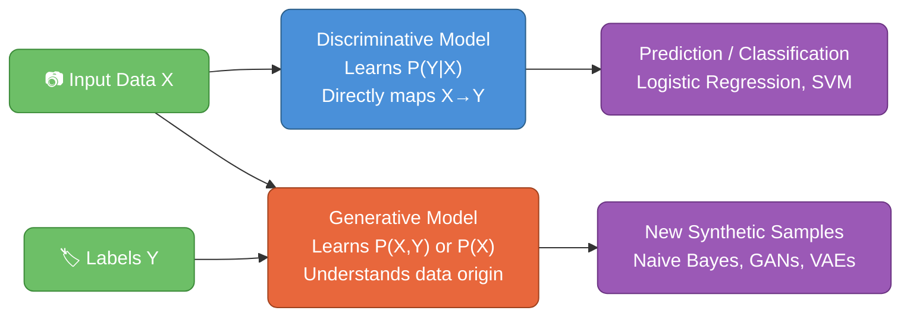
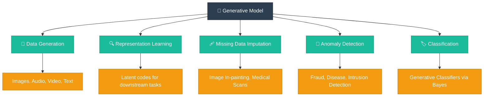
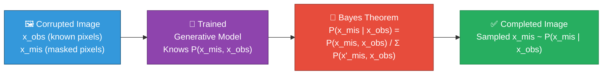
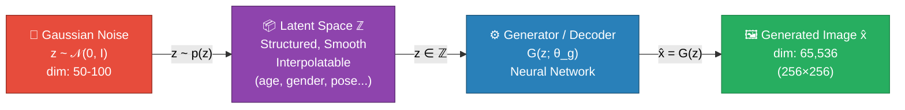
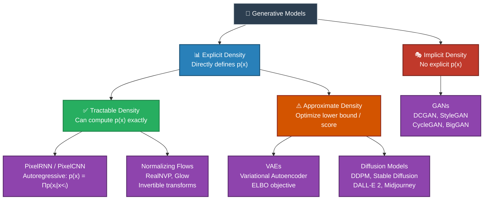
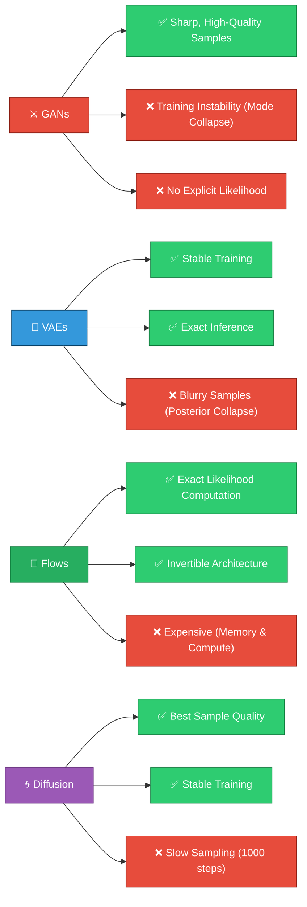

# 🧠 Module 6 — Introduction to Generative Models & GANs

> **Course:** Generative AI & Deep Learning — IIT Madras  
> **Faculty:** Prof. Balaji Srinivasan & Prof. Ganapathy Krishnamurthi  
> **School:** Wadhwani School of AI  
> **Topic:** Introduction to Generative Adversarial Networks (GANs) & Generative Models

---

## 📌 Table of Contents

1. [Discriminative vs Generative Models](#1-discriminative-vs-generative-models)
2. [What is a Generative Model?](#2-what-is-a-generative-model)
3. [Toy Example — 2×2 Binary Image Grid](#3-toy-example--22-binary-image-grid)
4. [Applications of Generative Models](#4-applications-of-generative-models)
5. [In-Painting & Bayes' Theorem](#5-in-painting--bayes-theorem)
6. [Generative Classifiers](#6-generative-classifiers)
7. [The Latent Space](#7-the-latent-space)
8. [Paradigm Shift: Pre-DL vs Modern](#8-paradigm-shift-pre-dl-vs-modern)
9. [Taxonomy of Generative Models](#9-taxonomy-of-generative-models)
10. [Tradeoffs Between Model Families](#10-tradeoffs-between-model-families)
11. [Key References](#11-key-references)

---

## 1. Discriminative vs Generative Models

At the heart of machine learning lie two fundamental paradigms for modeling data.



### Key Distinction

| Property | Discriminative | Generative |
|---|---|---|
| **What it learns** | $P(Y \mid X)$ | $P(X, Y)$ or $P(X)$ |
| **Goal** | Classify / predict labels | Understand & generate data |
| **Training signal** | Label supervision | Data distribution |
| **Can generate new samples?** | ❌ No | ✅ Yes |
| **Can do classification?** | ✅ Directly | ✅ Via Bayes' theorem |
| **Examples** | Logistic Regression, SVM, Neural Nets | Naive Bayes, LDA, GANs, VAEs, Diffusion |

> [!NOTE]
> Discriminative models are often simpler and more accurate for classification tasks alone. Generative models are more powerful in that they understand the full data-generating process, but they are harder to train.

---

## 2. What is a Generative Model?

> **Definition:** A *generative model* is a type of statistical model capable of **learning the underlying distribution of a dataset** in order to generate new, synthetic data samples that are similar to the original data.

### Core Idea — Mathematical Formulation

The goal is to train a model with parameters $\theta_g$ such that:

$$p_{\text{model}}(x;\, \theta_g) \approx p_{\text{data}}(x)$$

**Sampling procedure:**
1. Sample noise from a prior: $z \sim p(z)$ (e.g., $z \sim \mathcal{N}(0, I)$)
2. Pass through a generator network: $\hat{x} = G(z;\, \theta_g)$
3. The output $\hat{x}$ lives in the data space $\mathcal{X}$

The generator $G: \mathcal{Z} \to \mathcal{X}$ maps from the **latent space** $\mathcal{Z}$ to the **data space** $\mathcal{X}$.

### Key Features

- **Understands data origin** — models how data was generated
- **Models joint distribution** $P(X, Y)$
- **Generates new samples** — not just classifies
- **Learns latent space** — compact, structured representation

### Capabilities

| Capability | Description | Example |
|---|---|---|
| **Data Generation** | Synthesize new realistic samples | Generate faces, music, video |
| **Understanding Data** | Capture structure & patterns | Feature learning, clustering |
| **Missing Data Imputation** | Fill in missing values | In-painting corrupted images |
| **Anomaly Detection** | Low $p_{\text{model}}(x)$ → anomaly | Fraud detection, medical imaging |
| **Representation Learning** | Learn compact latent codes | Downstream classification |

> [!TIP]
> Real-world examples of generative models in action: **Google Imagen 2** (text-to-image), **Stable Diffusion XL** (image synthesis), **Meta AudioGen** (audio generation), **OpenAI Sora 2** (video generation).

---

## 3. Toy Example — 2×2 Binary Image Grid

To build intuition, consider the simplest possible image: a **2×2 grid of binary pixels**.

```
┌────┬────┐
│ x₁₁│ x₁₂│
├────┼────┤
│ x₂₁│ x₂₂│
└────┴────┘
  Each xᵢⱼ ∈ {0, 1}
```

Since each pixel is binary and there are 4 pixels:

$$\text{Total possible images} = 2^4 = 16$$

A generative model must learn the **joint distribution**:

$$P(x_{11},\, x_{12},\, x_{21},\, x_{22})$$

This is a probability distribution over all 16 possible configurations. Once learned, we can:

| Task | How |
|---|---|
| **Sample new images** | Draw from $P(x_{11}, x_{12}, x_{21}, x_{22})$ |
| **Marginalization** | Sum out variables: $P(x_{11}) = \sum_{x_{12}, x_{21}, x_{22}} P(\cdot)$ |
| **In-painting** | Condition on observed pixels and infer missing |
| **Classification** | Use $P(y \mid x)$ via Bayes' theorem |

> [!NOTE]
> This toy example scales catastrophically: a 256×256 grayscale image has $256^{256 \times 256}$ possible values — an astronomically large space. This is why we need **deep learning** and **latent spaces**.

---

## 4. Applications of Generative Models



---

## 5. In-Painting & Bayes' Theorem

**In-painting** refers to filling in missing (corrupted, occluded) parts of an image using the generative model.

### Setup

Partition the image pixels into:
- $x_{\text{obs}}$ — observed (known) pixels
- $x_{\text{mis}}$ — missing (to be inferred) pixels

### Bayes' Formula for In-painting

We want the conditional distribution of the missing pixels given the observed:

$$P(x_{\text{mis}} \mid x_{\text{obs}}) = \frac{P(x_{\text{mis}},\, x_{\text{obs}})}{\sum_{x'_{\text{mis}}} P(x'_{\text{mis}},\, x_{\text{obs}})}$$

**Steps:**
1. The generative model provides $P(x_{\text{mis}}, x_{\text{obs}})$ — the joint distribution.
2. The denominator normalizes by marginalizing out $x_{\text{mis}}$.
3. We can then sample from $P(x_{\text{mis}} \mid x_{\text{obs}})$ to fill in missing pixels.

> [!IMPORTANT]
> This is only possible because the generative model has learned the **full joint distribution** $P(X)$. A discriminative model cannot do this — it only models $P(Y \mid X)$, not the data distribution itself.

### In-Painting Flow



---

## 6. Generative Classifiers

A surprising application: generative models can perform **classification** using Bayes' theorem!

### Formula

$$P(y = c \mid x) = \frac{P(x \mid y = c)\, P(y = c)}{P(x)}$$

Where:
- $P(x \mid y = c)$ — class-conditional likelihood (learned by generative model)
- $P(y = c)$ — prior probability of class $c$
- $P(x) = \sum_c P(x \mid y = c)\, P(y = c)$ — evidence (normalizing constant)

### Generative vs Discriminative Classifiers

| | **Generative Classifiers** | **Discriminative Classifiers** |
|---|---|---|
| **Models** | Naive Bayes, LDA (Linear Discriminant Analysis) | Logistic Regression, SVM, Neural Networks |
| **What they learn** | $P(X \mid Y)$ and $P(Y)$ separately | $P(Y \mid X)$ directly |
| **Can generate data?** | ✅ Yes | ❌ No |
| **Data efficiency** | ✅ Better with less data | ❌ Needs more data |
| **Accuracy** | Often lower for pure classification | Often higher for pure classification |
| **Assumption** | Models full data distribution | Models decision boundary only |
| **Training** | Maximum Likelihood Estimation of $P(X, Y)$ | Maximum Likelihood of $P(Y \mid X)$ |

> [!TIP]
> **Ng & Jordan (2002)** showed that generative classifiers (Naive Bayes) approach their asymptotic error faster with fewer training samples, while discriminative classifiers (Logistic Regression) have a lower asymptotic error with enough data.

---

## 7. The Latent Space

### The Dimensionality Problem

Real-world images are **extremely high-dimensional**:
- A 256×256 image has $256 \times 256 = 65{,}536$ pixel dimensions
- Even small perturbations in pixel space can completely change meaning

### Latent Space to the Rescue

The **latent space** $\mathcal{Z}$ is a lower-dimensional representation that captures the **essential structure** of the data:

$$x \in \mathbb{R}^{65536} \xrightarrow{\text{Encoder}} z \in \mathbb{R}^{50}$$

A 50-dimensional latent vector might encode meaningful factors like:
- Age, Gender, Pose, Lighting (for faces)
- Style, Genre, Tempo (for music)
- Object category, Shape, Color (for objects)



### Historical Context: Learning Latent Representations

| Era | Method | Description |
|---|---|---|
| **Pre-DL** | PCA / Eigenfaces | Linear projection, finds directions of max variance |
| **Pre-DL** | Factor Analysis | Probabilistic latent factor model |
| **Pre-DL** | LDA | Supervised linear latent dimensions |
| **Pre-DL** | Matrix Factorization (SVD) | Decomposes data matrix into latent factors |
| **Modern DL** | VAE | Probabilistic encoder-decoder, smooth latent space |
| **Modern DL** | GAN | Implicit density, generator trained adversarially |
| **Modern DL** | Normalizing Flows | Exact likelihood with invertible transformations |
| **Modern DL** | Diffusion Models | Iterative denoising from Gaussian noise |

### The Paradigm Shift in Latent Learning

**Old (Pre-DL):**
```
Data X → Encoder → Latent z
(Disjointed, unstructured, no generation)
```

**New (Deep Learning):**
```
Gaussian Noise z → Decoder/Generator G → New Data x̂
(Structured, smooth, generative!)
```

> [!IMPORTANT]
> The key insight of modern generative models is to **start from structured Gaussian noise** and learn to transform it into realistic data — rather than trying to encode existing data into an unstructured latent space.

### Noise Creates Variety

- **Toy model (2×2):** Directly sample from the 16-image distribution
- **Deep model:** Sample $z \sim \mathcal{N}(0, I)$ → different $z$ → different realistic outputs
- The **entire diversity** of the data distribution is captured in $p(z)$ + the generator $G$

---

## 8. Paradigm Shift: Pre-DL vs Modern

| Dimension | Pre-Deep Learning | Modern Deep Learning |
|---|---|---|
| **Goal** | Discovery & Representation | Generation & Creation |
| **Direction** | Data → Latent (Encoding) | Noise → Data (Decoding/Generation) |
| **Latent structure** | Unstructured, disjointed | Structured Gaussian, smooth, interpolatable |
| **Methods** | PCA, Factor Analysis, SVD, LDA | GANs, VAEs, Flows, Diffusion |
| **Scalability** | Limited to linear/shallow | Billions of parameters, massive scale |
| **Output quality** | Low-dimensional summaries | Photorealistic images, coherent text, audio |
| **Training** | Closed-form or EM | Backprop, adversarial training, score matching |

> [!NOTE]
> This shift mirrors a broader change in AI philosophy: from **analysis** (understanding what exists) to **synthesis** (creating what could exist).

---

## 9. Taxonomy of Generative Models

Generative models are classified by **how they represent the probability density** $p(x)$.



### Taxonomy Table

| Family | Type | Density | Examples | Key Idea |
|---|---|---|---|---|
| **Autoregressive** | Explicit Tractable | Exact | PixelRNN, PixelCNN | Factorize $p(x) = \prod_i p(x_i \mid x_{<i})$ |
| **Normalizing Flows** | Explicit Tractable | Exact | RealNVP, Glow | Invertible bijections: $p(x) = p(f^{-1}(x)) \cdot \|\det J\|^{-1}$ |
| **VAEs** | Explicit Approximate | ELBO lower bound | VAE, $\beta$-VAE, VQ-VAE | Maximize Evidence Lower BOund (ELBO) |
| **Diffusion Models** | Explicit Approximate | Score-based | DDPM, Stable Diffusion, DALL-E 2 | Reverse a gradual noising process |
| **GANs** | Implicit | None (implicit) | DCGAN, StyleGAN, CycleGAN | Adversarial game: Generator vs Discriminator |

---

## 10. Tradeoffs Between Model Families



### Head-to-Head Comparison

| Criterion | GANs | VAEs | Normalizing Flows | Diffusion Models |
|---|---|---|---|---|
| **Sample Quality** | 🟡 Very High | 🔴 Blurry | 🟡 High | 🟢 State-of-the-art |
| **Training Stability** | 🔴 Unstable | 🟢 Stable | 🟢 Stable | 🟢 Stable |
| **Likelihood Computation** | 🔴 None | 🟡 ELBO (approx) | 🟢 Exact | 🟡 Approx (ELBO) |
| **Inference Speed** | 🟢 Fast (1 forward pass) | 🟢 Fast | 🟡 Moderate | 🔴 Slow (many steps) |
| **Mode Coverage** | 🔴 Mode collapse risk | 🟢 Good coverage | 🟢 Good coverage | 🟢 Excellent coverage |
| **Latent Space Quality** | 🔴 Unstructured | 🟢 Smooth, structured | 🟡 Moderate | 🟡 Moderate |
| **Memory** | 🟢 Efficient | 🟢 Efficient | 🔴 Expensive | 🟡 Moderate |
| **Key Models** | DCGAN, StyleGAN | VAE, $\beta$-VAE | Glow, RealNVP | DDPM, Stable Diffusion |

> [!WARNING]
> **Mode collapse** is a major failure mode in GANs: the generator learns to produce only a small subset of the true data distribution (e.g., generating only one type of face). This is because the adversarial objective does not explicitly enforce coverage of $p_{\text{data}}$.

> [!TIP]
> In practice, **Diffusion Models** (e.g., Stable Diffusion, DALL-E 2) currently dominate image generation due to their superior sample quality and training stability, despite being slower at inference. Techniques like **DDIM** and **Consistency Models** have significantly accelerated sampling.

---

## 11. Key References

| Paper | Authors | Year | Contribution |
|---|---|---|---|
| **Generative Adversarial Nets** | Goodfellow et al. | 2014 | Introduced the GAN framework |
| **Unsupervised Representation Learning with DCGAN** | Radford et al. | 2015 | Stable deep convolutional GAN architecture |
| **A Style-Based Generator Architecture for GANs** | Karras et al. | 2019 | StyleGAN: disentangled latent control |
| **Auto-Encoding Variational Bayes** | Kingma & Welling | 2013 | Variational Autoencoder (VAE) |
| **Denoising Diffusion Probabilistic Models** | Ho et al. | 2020 | DDPM: foundation of modern diffusion models |
| **Density estimation using Real-valued NVP** | Dinh et al. | 2017 | RealNVP normalizing flow |
| **Pixel Recurrent Neural Networks** | van den Oord et al. | 2016 | PixelRNN autoregressive model |
| **On Discriminative vs. Generative Classifiers** | Ng & Jordan | 2002 | Formal comparison of generative/discriminative |

---

## 🗂️ Quick Summary

> [!IMPORTANT]
> **Core Takeaways from This Module:**
>
> 1. **Generative models** learn $p_{\text{model}}(x) \approx p_{\text{data}}(x)$ — the full data distribution.
> 2. They enable **data generation, imputation, anomaly detection, and classification** via Bayes' theorem.
> 3. The **latent space** $\mathcal{Z}$ is a low-dimensional, structured space that captures essential data factors.
> 4. The **paradigm shift**: Pre-DL mapped Data→Latent (unstructured); Modern DL maps Noise→Data (structured).
> 5. Generative model families: **Autoregressive**, **Normalizing Flows**, **VAEs**, **Diffusion Models**, **GANs**.
> 6. **GANs** (Goodfellow 2014): Implicit density, adversarial training — sharp but unstable.
> 7. **VAEs** (Kingma 2013): ELBO objective — stable but blurry.
> 8. **Diffusion** (Ho 2020): Best quality, stable — but slow at inference.

---

*Notes prepared from Module 6 lecture slides — IIT Madras Wadhwani School of AI*  
*Cross-reference with lecture recordings and assignment notebooks for exercises.*
