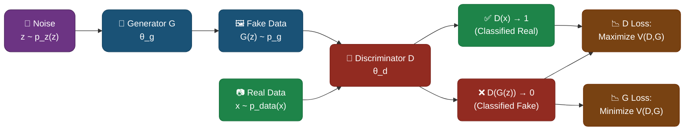
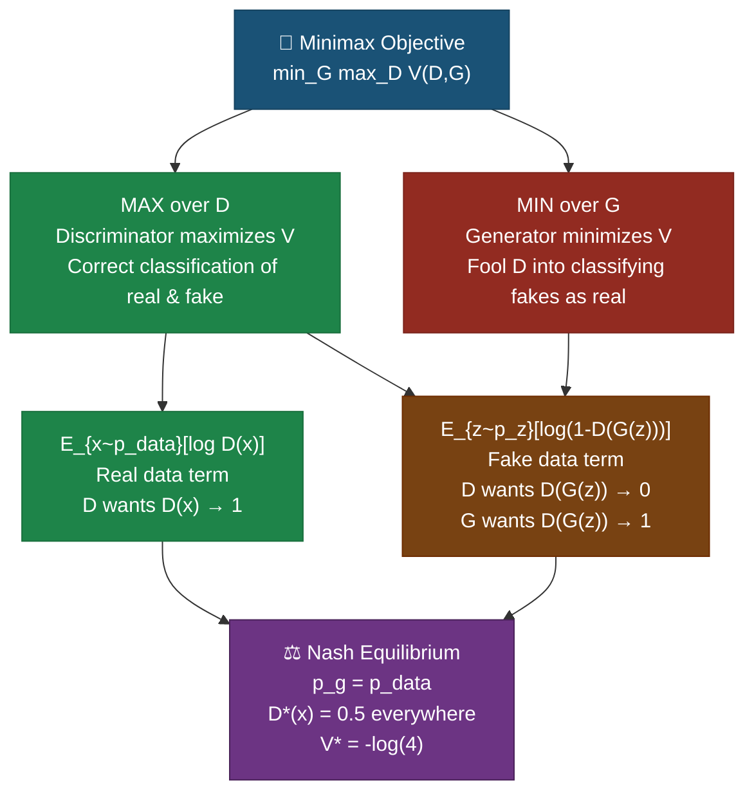
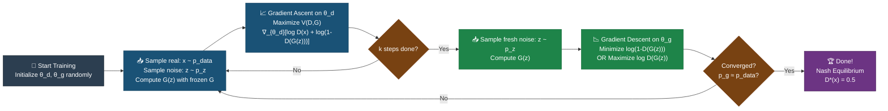
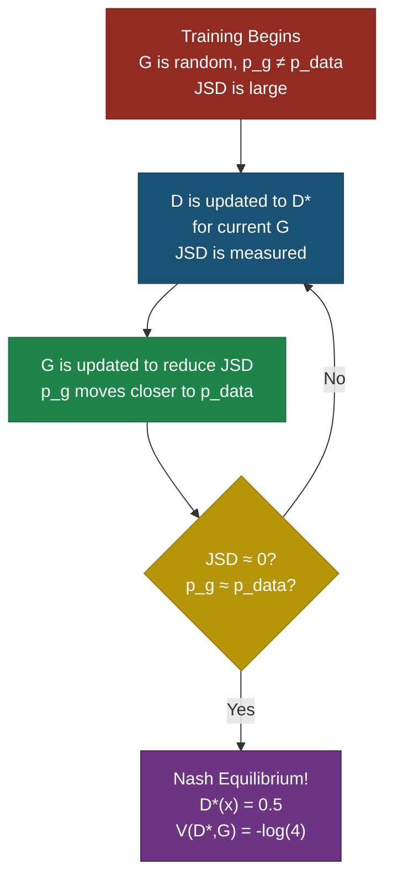
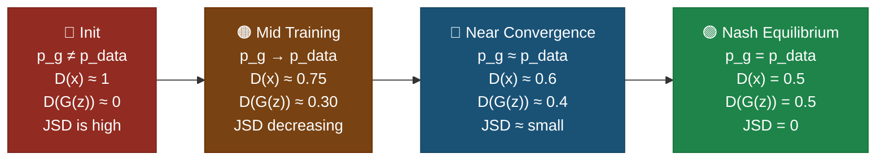

# 02 — GAN Theory & Mathematics

> **Module 6: Generative AI & Deep Learning**
> *Prof. Balaji Srinivasan & Ganapathy Krishnamurthi — Wadhwani School of AI, IIT Madras*
> Reference: Goodfellow et al., 2014 — *"Generative Adversarial Nets"*, NeurIPS

---

## Table of Contents

1. [Motivation & Intuition](#1-motivation--intuition)
2. [The Two-Player Game](#2-the-two-player-game)
3. [Discriminator Objective](#3-discriminator-objective)
4. [Generator Objective](#4-generator-objective)
5. [The Minimax Objective](#5-the-minimax-objective)
6. [Binary Cross-Entropy Connection](#6-binary-cross-entropy-connection)
7. [Training Algorithm](#7-training-algorithm)
8. [Optimal Discriminator Derivation](#8-optimal-discriminator-derivation)
9. [Jensen-Shannon Divergence Connection](#9-jensen-shannon-divergence-connection)
10. [Nash Equilibrium & Convergence](#10-nash-equilibrium--convergence)
11. [Practical Notes from Notebook](#11-practical-notes-from-notebook)
12. [Summary Cheat Sheet](#12-summary-cheat-sheet)

---

## 1. Motivation & Intuition

### The Art Forgery Analogy

GANs were proposed by **Ian Goodfellow et al. in 2014** and introduced a radically new approach to generative modelling — framing it as a **competitive game** between two neural networks.

| Role | Network | Goal |
|---|---|---|
| 🎨 Aspiring Artist | **Generator G** | Create convincing forgeries to fool the critic |
| 🧐 Art Critic | **Discriminator D** | Distinguish real masterpieces from fakes |

> [!NOTE]
> The game ends when the artist's forgeries fool the critic approximately **50% of the time** — meaning the critic can do no better than random guessing. This is the **Nash Equilibrium**.

### What does each network see?

```
Real Data (p_data) ──────────────────────────────────────────► D ──► Real/Fake?
                                                               ▲
Noise z ~ p_z  ──► G ──► Fake Data (p_g) ──────────────────────
```

---

## 2. The Two-Player Game



> [!IMPORTANT]
> **Generator G** never sees real data directly. It only receives gradient signals through the Discriminator's output — this is the essence of adversarial training.

---

## 3. Discriminator Objective

The Discriminator is a **binary classifier**. For a given Generator G, it wants to:
- Output **D(x) → 1** for real data $x \sim p_{data}$
- Output **D(G(z)) → 0** for fake data $G(z)$ where $z \sim p_z$

Its objective is to **maximize**:

$$V_D = \mathbb{E}_{x \sim p_{data}(x)}\bigl[\log D(x)\bigr] + \mathbb{E}_{z \sim p_z(z)}\bigl[\log(1 - D(G(z)))\bigr]$$

### Term-by-term analysis:

| Term | Quantity | What D wants |
|---|---|---|
| $\mathbb{E}_{x \sim p_{data}}[\log D(x)]$ | Log-prob of calling real "real" | Maximize → push $D(x) \to 1$ |
| $\mathbb{E}_{z \sim p_z}[\log(1 - D(G(z)))]$ | Log-prob of calling fake "fake" | Maximize → push $D(G(z)) \to 0$ |

> [!TIP]
> Both log terms are ≤ 0. Maximizing means pushing them as close to **0** as possible. When $D(x)=1$, $\log 1 = 0$ ✓. When $D(G(z))=0$, $\log(1-0)=0$ ✓.

---

## 4. Generator Objective

The Generator wants to **fool** the Discriminator, i.e. make $D(G(z)) \to 1$.

### Original (Minimax) form — minimize:

$$\mathcal{L}_G^{\text{minimax}} = \mathbb{E}_{z \sim p_z(z)}\bigl[\log(1 - D(G(z)))\bigr]$$

### Problem: Vanishing Gradients at the Start 🚨

When G is weak (early training), $D(G(z)) \approx 0$, so:

$$\frac{d}{d\theta_g}\log(1 - D(G(z))) \approx 0 \quad \text{(gradient saturates)}$$

The loss is flat where G needs the most help!

### Non-Saturating Heuristic (Goodfellow 2014) — maximize:

$$\mathcal{L}_G^{\text{NS}} = \mathbb{E}_{z \sim p_z(z)}\bigl[\log D(G(z))\bigr]$$

> [!IMPORTANT]
> The **non-saturating** form is used in practice. It has the same fixed point (Nash equilibrium) as the minimax form but provides **much stronger gradients** early in training.

**Comparison of gradient behaviour:**

| Form | Gradient when $D(G(z)) \approx 0$ |
|---|---|
| $\log(1 - D(G(z)))$ | ≈ 0 (saturated 😞) |
| $-\log D(G(z))$ | Very large (strong signal 😊) |

---

## 5. The Minimax Objective

The full GAN game is a **minimax** problem:

$$\boxed{\min_G \max_D \; V(D,G) = \mathbb{E}_{x \sim p_{data}(x)}\bigl[\log D(x)\bigr] + \mathbb{E}_{z \sim p_z(z)}\bigl[\log(1 - D(G(z)))\bigr]}$$



> [!NOTE]
> The outer **min** is over G's parameters $\theta_g$, and the inner **max** is over D's parameters $\theta_d$. These are optimised in alternating steps, not simultaneously.

---

## 6. Binary Cross-Entropy Connection

The GAN objective is directly related to **Binary Cross-Entropy (BCE)**:

$$\text{BCE}(y, \hat{y}) = -\bigl[y \cdot \log(\hat{y}) + (1-y) \cdot \log(1-\hat{y})\bigr]$$

For the Discriminator:

| Sample | Label $y$ | BCE Loss |
|---|---|---|
| Real $x \sim p_{data}$ | $y = 1$ | $-\log D(x)$ |
| Fake $G(z)$ | $y = 0$ | $-\log(1 - D(G(z)))$ |

The combined D loss over a mini-batch of size $m$:

$$\mathcal{L}_D = -\frac{1}{m}\sum_{i=1}^{m}\Bigl[\log D(x^{(i)}) + \log\bigl(1 - D(G(z^{(i)}))\bigr)\Bigr]$$

**Minimizing BCE = Maximizing V(D,G) for D** ✓

> [!TIP]
> In PyTorch, `nn.BCELoss()` with labels `1` for real and `0` for fake directly implements the discriminator's part of the GAN objective. For the generator, use labels `1` for fake samples (since G wants D to call them real).

---

## 7. Training Algorithm

GAN training uses **alternating optimization** — D and G are never updated simultaneously.

### Pseudocode

```
Algorithm: GAN Training (Goodfellow et al., 2014)
─────────────────────────────────────────────────
Hyperparameters: k (D steps per G step), α (learning rate), m (batch size)

repeat until convergence:

    ┌─────────────────────────────────────────────────┐
    │  PHASE 1: Train Discriminator (freeze G)        │
    │                                                 │
    │  for step = 1 to k do:                          │
    │    Sample {x^(1),...,x^(m)} ~ p_data           │
    │    Sample {z^(1),...,z^(m)} ~ p_z              │
    │                                                 │
    │    Gradient ASCENT on θ_d:                      │
    │                                                 │
    │    θ_d ← θ_d + α · ∇_{θ_d}                    │
    │      [ (1/m) Σ_i log D(x^(i))                  │
    │          + log(1 - D(G(z^(i)))) ]              │
    └─────────────────────────────────────────────────┘

    ┌─────────────────────────────────────────────────┐
    │  PHASE 2: Train Generator (freeze D)            │
    │                                                 │
    │  Sample {z^(1),...,z^(m)} ~ p_z  (fresh)       │
    │                                                 │
    │  Gradient DESCENT on θ_g:                       │
    │                                                 │
    │  θ_g ← θ_g - α · ∇_{θ_g}                      │
    │      [ (1/m) Σ_i log(1 - D(G(z^(i)))) ]       │
    │                                                 │
    │  (or equivalently, gradient ASCENT on:          │
    │      (1/m) Σ_i log D(G(z^(i)))  )              │
    └─────────────────────────────────────────────────┘
```

> [!WARNING]
> Fresh noise samples **must** be drawn for the Generator update phase. Reusing the same $z$ used to train D can introduce bias and correlations that harm convergence.

### Training Flow Diagram



---

## 8. Optimal Discriminator Derivation

> [!IMPORTANT]
> This is the core theoretical result of Goodfellow 2014. We derive the **optimal discriminator $D^*$** for a fixed generator G.

### Setup

For a fixed G, the value function becomes a functional of D:

$$V(D, G) = \int_x p_{data}(x) \log D(x) \, dx + \int_z p_z(z) \log(1 - D(G(z))) \, dz$$

Changing variables in the second integral ($x = G(z)$, so $z$ induces distribution $p_g$ on $x$):

$$V(D, G) = \int_x \Bigl[ p_{data}(x) \log D(x) + p_g(x) \log(1 - D(x)) \Bigr] dx$$

### Pointwise Optimization

For each $x$, we maximize the integrand over $D(x) \in [0,1]$:

$$f(d) = p_{data}(x) \log d + p_g(x) \log(1-d)$$

Taking the derivative and setting to zero:

$$\frac{df}{dd} = \frac{p_{data}(x)}{d} - \frac{p_g(x)}{1-d} = 0$$

Solving:

$$p_{data}(x)(1-d) = p_g(x) \cdot d$$

$$p_{data}(x) = d\bigl(p_{data}(x) + p_g(x)\bigr)$$

$$\boxed{D^*(x) = \frac{p_{data}(x)}{p_{data}(x) + p_g(x)}}$$

### Verification

| Scenario | $D^*(x)$ | Interpretation |
|---|---|---|
| $p_g(x) = p_{data}(x)$ | $\frac{p_{data}}{2p_{data}} = \frac{1}{2}$ | Nash equilibrium — D is 50/50 |
| $p_g(x) = 0$ (no fakes at $x$) | $\frac{p_{data}}{p_{data}} = 1$ | D correctly says "real" |
| $p_{data}(x) = 0$ (no reals at $x$) | $\frac{0}{p_g} = 0$ | D correctly says "fake" |

> [!NOTE]
> The optimal discriminator is never trained to output $D^* = 0.5$ everywhere — it **naturally converges** to $0.5$ when and only when $p_g = p_{data}$, i.e. when the generator has fully converged.

---

## 9. Jensen-Shannon Divergence Connection

### Substituting $D^*$ into the Minimax Objective

Plug $D^*(x) = \frac{p_{data}}{p_{data} + p_g}$ back into $V(D^*, G)$:

$$V(D^*, G) = \mathbb{E}_{x \sim p_{data}}\!\left[\log \frac{p_{data}(x)}{p_{data}(x)+p_g(x)}\right] + \mathbb{E}_{x \sim p_g}\!\left[\log \frac{p_g(x)}{p_{data}(x)+p_g(x)}\right]$$

Let $M = \frac{p_{data} + p_g}{2}$ (mixture distribution). Then:

$$V(D^*, G) = \mathbb{E}_{x \sim p_{data}}\!\left[\log \frac{p_{data}(x)}{2 M(x)}\right] + \mathbb{E}_{x \sim p_g}\!\left[\log \frac{p_g(x)}{2 M(x)}\right]$$

$$= \mathbb{E}_{x \sim p_{data}}\!\left[\log p_{data}(x) - \log(2M(x))\right] + \mathbb{E}_{x \sim p_g}\!\left[\log p_g(x) - \log(2M(x))\right]$$

$$= -\log 4 + \text{KL}(p_{data} \| M) + \text{KL}(p_g \| M)$$

### Jensen-Shannon Divergence

The **Jensen-Shannon Divergence** is defined as:

$$\text{JSD}(P \| Q) = \frac{1}{2}\text{KL}(P \| M) + \frac{1}{2}\text{KL}(Q \| M), \quad M = \frac{P+Q}{2}$$

**Properties:**
- $\text{JSD}(P\|Q) \geq 0$ always
- $\text{JSD}(P\|Q) = 0 \iff P = Q$
- Symmetric: $\text{JSD}(P\|Q) = \text{JSD}(Q\|P)$
- Bounded: $0 \leq \text{JSD} \leq \log 2$

Therefore:

$$\boxed{V(D^*, G) = -\log 4 + 2 \cdot \text{JSD}(p_{data} \| p_g)}$$

> [!IMPORTANT]
> **The GAN minimax game, when the discriminator is optimal, is equivalent to minimizing the Jensen-Shannon Divergence between $p_{data}$ and $p_g$.** This gives the theoretical guarantee that the generator learns the true data distribution.

### Global Minimum

$$\min_G V(D^*, G) = -\log 4 \quad \text{achieved when } p_g = p_{data}$$

At this point: $\text{JSD}(p_{data} \| p_g) = 0$. ✓



---

## 10. Nash Equilibrium & Convergence

### Definition

A **Nash Equilibrium** in the GAN game is a pair $(G^*, D^*)$ such that neither player can improve their own objective by unilaterally changing their strategy.

For GANs, this occurs when:

$$p_g = p_{data} \quad \text{and} \quad D^*(x) = \frac{1}{2} \;\forall x$$

### Formal Theorem (Goodfellow 2014)

> **Theorem:** The global minimum of the minimax game is achieved if and only if $p_g = p_{data}$. At this point, the value of the game is $V(D^*, G^*) = -\log 4$.

### Training Dynamics — Conceptual Loss Landscape

| Phase | $D_{loss}$ | $G_{loss}$ | Interpretation |
|---|---|---|---|
| Early (G is bad) | Low | High | D easily distinguishes; G can't fool it |
| Mid training | Rising | Falling | G improves; D struggles more |
| Near equilibrium | ~$\log 2$ ≈ 0.693 | ~$\log 2$ ≈ 0.693 | Both converging |
| At Nash Eq. | $-\log(4)/2$ = $\log 2$ | $\log 2$ | $D(x) = 0.5$ everywhere |

> [!WARNING]
> **Mode Collapse**: A known failure mode where G generates only a few highly convincing samples to fool D, rather than learning the full data distribution. The GAN can reach a local equilibrium far from the Nash equilibrium.

> [!CAUTION]
> **Training Instability**: The alternating optimization can oscillate rather than converge. If D is too strong, G gets no useful gradient. If D is too weak, G gets misleading gradients. Careful hyperparameter tuning is essential.

---

## 11. Practical Notes from Notebook

### Hyperparameters Used

```python
latent_size = 64        # Dimension of noise vector z
batch_size  = 100       # Mini-batch size m
lr          = 0.0002    # Adam optimizer learning rate
betas       = (0.5, 0.999)  # Adam momentum params (common for GANs)
loss_fn     = nn.BCELoss()
```

### Training Results

| Metric | Value | Interpretation |
|---|---|---|
| Final $D_{loss}$ | 0.8781 | Above $\log 2 \approx 0.693$; not fully converged |
| Final $G_{loss}$ | 1.5290 | G still improving |
| Avg $D_{loss}$ | 0.7651 | Close to equilibrium value |
| Avg $G_{loss}$ | 2.0232 | G struggled mid-training |
| $D(x)$ at end | ≈ 0.75 | D still correctly labels some reals |
| $D(G(z))$ at end | ≈ 0.30 | D still catching some fakes |

> [!NOTE]
> At Nash equilibrium we expect $D(x) \approx 0.5$ and $D(G(z)) \approx 0.5$. The values $D(x) \approx 0.75$ and $D(G(z)) \approx 0.30$ indicate the model is still training and has not fully converged, which is normal for a moderate number of epochs.

> [!TIP]
> A common diagnostic: plot $D(x)$ and $D(G(z))$ over training epochs. At convergence, both should approach **0.5**. If $D(x)$ stays near 1 and $D(G(z))$ near 0, the discriminator is dominating and you should reduce its learning rate or add noise to labels.

### PyTorch Training Loop Sketch

```python
for epoch in range(num_epochs):
    for real_imgs, _ in dataloader:

        # ─── Phase 1: Train Discriminator ───────────────────
        optimizer_D.zero_grad()

        z = torch.randn(batch_size, latent_size)   # z ~ p_z
        fake_imgs = G(z).detach()                  # freeze G

        d_real = D(real_imgs)
        d_fake = D(fake_imgs)

        loss_D = (BCE(d_real, ones) + BCE(d_fake, zeros)) / 2
        loss_D.backward()
        optimizer_D.step()

        # ─── Phase 2: Train Generator ────────────────────────
        optimizer_G.zero_grad()

        z = torch.randn(batch_size, latent_size)   # fresh z
        fake_imgs = G(z)                           # don't detach!

        d_fake = D(fake_imgs)
        loss_G = BCE(d_fake, ones)                 # fool D → label as real

        loss_G.backward()
        optimizer_G.step()
```

---

## 12. Summary Cheat Sheet

### Key Equations

| Name | Formula |
|---|---|
| Minimax objective | $\min_G \max_D \; \mathbb{E}[\log D(x)] + \mathbb{E}[\log(1-D(G(z)))]$ |
| Optimal discriminator | $D^*(x) = \dfrac{p_{data}(x)}{p_{data}(x) + p_g(x)}$ |
| At equilibrium | $D^*(x) = \tfrac{1}{2},\quad p_g = p_{data}$ |
| Game value at opt D | $V(D^*,G) = -\log 4 + 2\,\text{JSD}(p_{data}\|p_g)$ |
| Global minimum | $V^* = -\log 4$ when $p_g = p_{data}$ |
| JSD | $\tfrac{1}{2}\text{KL}(P\|M) + \tfrac{1}{2}\text{KL}(Q\|M),\; M = \tfrac{P+Q}{2}$ |
| BCE loss | $-[y\log\hat{y} + (1-y)\log(1-\hat{y})]$ |

### Decision Boundary Evolution



---

## References

1. **Goodfellow, I., Pouget-Abadie, J., Mirza, M., Xu, B., Warde-Farley, D., Ozair, S., Courville, A., & Bengio, Y.** (2014). *Generative Adversarial Nets*. Advances in Neural Information Processing Systems (NeurIPS), 27.
2. **Goodfellow, I.** (2016). *NIPS 2016 Tutorial: Generative Adversarial Networks*. arXiv:1701.00160.
3. **Shannon, C.E.** (1948). *A Mathematical Theory of Communication*. Bell System Technical Journal.
4. **Kullback, S., & Leibler, R.A.** (1951). *On Information and Sufficiency*. Annals of Mathematical Statistics.

---

*Notes compiled for IIT Madras — Wadhwani School of AI, Module 6: Generative AI & Deep Learning*
*Prof. Balaji Srinivasan & Ganapathy Krishnamurthi*
