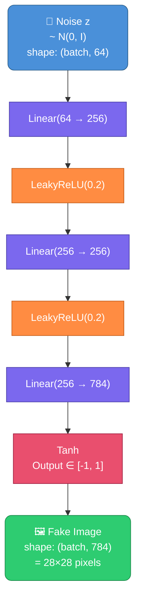
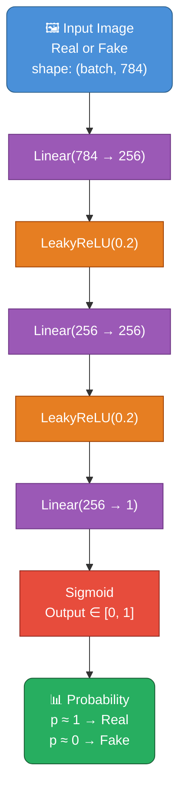
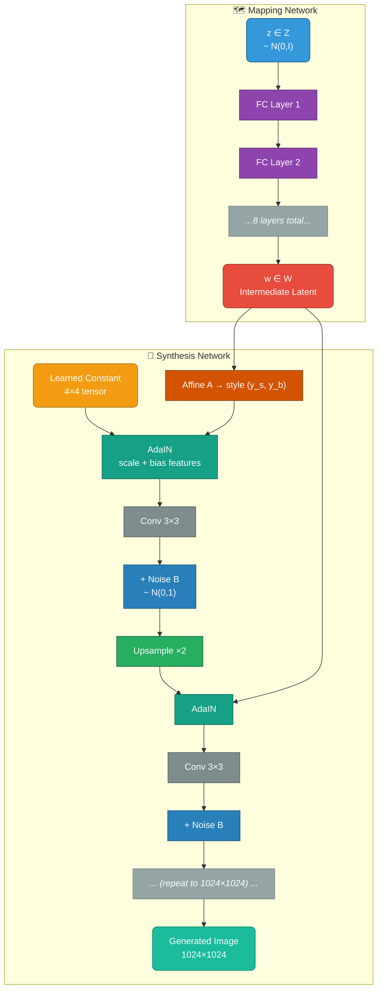
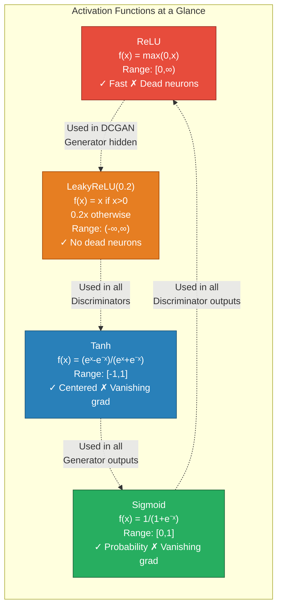

# Module 6 — GAN Architectures
**IIT Madras | Wadhwani School of AI**  
*Prof. Balaji Srinivasan & Ganapathy Krishnamurthi*

---

## Table of Contents
1. [What is a GAN?](#1-what-is-a-gan)
2. [Vanilla GAN Architecture](#2-vanilla-gan-architecture)
3. [DCGAN Architecture](#3-dcgan-architecture)
4. [StyleGAN Architecture](#4-stylegan-architecture)
5. [Activation Functions Deep Dive](#5-activation-functions-deep-dive)
6. [Latent Space](#6-latent-space)
7. [Architecture Comparison Table](#7-architecture-comparison-table)

---

## 1. What is a GAN?

A **Generative Adversarial Network (GAN)** consists of two networks locked in a minimax game:

| Network | Role | Input | Output |
|---|---|---|---|
| **Generator (G)** | Creates fake samples | Noise vector $z$ | Fake image $\hat{x}$ |
| **Discriminator (D)** | Judges real vs fake | Image $x$ or $\hat{x}$ | Probability $p \in [0,1]$ |

The training objective is:

$$\min_G \max_D \; \mathbb{E}_{x \sim p_{data}}[\log D(x)] + \mathbb{E}_{z \sim p_z}[\log(1 - D(G(z)))]$$

> [!IMPORTANT]
> The Generator never sees real data — it only receives gradient signals through the Discriminator. The Discriminator never sees Generator internals — it only receives generated images.

---

## 2. Vanilla GAN Architecture

### 2.1 Hyperparameters

```
latent_size  = 64      # Dimensionality of noise vector z
hidden_size  = 256     # Width of hidden layers
image_size   = 784     # 28 × 28 FashionMNIST pixels (flattened)
num_epochs   = 100
batch_size   = 100
device       = CUDA (Tesla T4, 15.83 GB)
```

---

### 2.2 Generator

**Architecture:**

```
z ~ N(0, I)   shape: (batch, 64)
       │
 Linear(64 → 256)
 LeakyReLU(0.2)
       │
 Linear(256 → 256)
 LeakyReLU(0.2)
       │
 Linear(256 → 784)
 Tanh
       │
 Fake image  shape: (batch, 784)  ∈ [-1, 1]
```

**Total parameters: 283,920**

```python
class Generator(nn.Module):
    def __init__(self):
        super().__init__()
        self.model = nn.Sequential(
            nn.Linear(latent_size, hidden_size),
            nn.LeakyReLU(0.2),
            nn.Linear(hidden_size, hidden_size),
            nn.LeakyReLU(0.2),
            nn.Linear(hidden_size, image_size),
            nn.Tanh()
        )

    def forward(self, x):
        return self.model(x)
```

> [!NOTE]
> `Tanh` is used at the Generator output because input images are normalized to $[-1, 1]$. This ensures generated images live in the same range.

---

### 2.3 Discriminator

**Architecture:**

```
Real/Fake image   shape: (batch, 784)
       │
 Linear(784 → 256)
 LeakyReLU(0.2)
       │
 Linear(256 → 256)
 LeakyReLU(0.2)
       │
 Linear(256 → 1)
 Sigmoid
       │
 Probability p ∈ [0, 1]
```

**Total parameters: 267,009**

```python
class Discriminator(nn.Module):
    def __init__(self):
        super().__init__()
        self.model = nn.Sequential(
            nn.Linear(image_size, hidden_size),
            nn.LeakyReLU(0.2),
            nn.Linear(hidden_size, hidden_size),
            nn.LeakyReLU(0.2),
            nn.Linear(hidden_size, 1),
            nn.Sigmoid()
        )

    def forward(self, x):
        return self.model(x)
```

> [!TIP]
> `LeakyReLU(0.2)` is preferred in the Discriminator over `ReLU` to avoid dead neurons — it allows a small negative gradient (slope = 0.2) for negative inputs, keeping gradients flowing even when neurons aren't activated.

---

### 2.4 Generator Architecture Diagram



---

### 2.5 Discriminator Architecture Diagram



---

### 2.6 Training Loop

```python
# Training step — Discriminator
optimizer_D.zero_grad()
real_labels = torch.ones(batch_size, 1).to(device)
fake_labels = torch.zeros(batch_size, 1).to(device)

# Real images loss
outputs = D(real_images)
d_loss_real = criterion(outputs, real_labels)

# Fake images loss
z = torch.randn(batch_size, latent_size).to(device)
fake_images = G(z)
outputs = D(fake_images.detach())   # detach: don't backprop into G
d_loss_fake = criterion(outputs, fake_labels)

d_loss = d_loss_real + d_loss_fake
d_loss.backward()
optimizer_D.step()

# Training step — Generator
optimizer_G.zero_grad()
outputs = D(fake_images)
g_loss = criterion(outputs, real_labels)   # G wants D to output 1
g_loss.backward()
optimizer_G.step()
```

> [!WARNING]
> Always call `.detach()` on fake images when computing Discriminator loss. Without it, gradients flow back through G unnecessarily, causing incorrect gradient updates and wasted computation.

---

## 3. DCGAN Architecture

**Reference:** Radford et al. 2015 — *"Unsupervised Representation Learning with Deep Convolutional Generative Adversarial Networks"*

### 3.1 Core Design Guidelines

| # | Guideline | Reason |
|---|---|---|
| 1 | **Replace pooling** with strided convolutions (D) and transposed convolutions (G) | Learned downsampling/upsampling vs fixed |
| 2 | **Batch Normalization** in both G and D | Stabilizes training, reduces mode collapse |
| 3 | **No fully connected hidden layers** | Spatial structure preserved |
| 4 | **ReLU** in G (all layers); **LeakyReLU** in D | Empirically better image quality |
| 5 | **Tanh** in G output | Match image range $[-1, 1]$ |
| 6 | **NO BatchNorm** on G output or D input | Prevents signal distortion |

### 3.2 Convolution Operations

- **Discriminator (downsampling):** Strided convolutions — $\text{stride} > 1$ reduces spatial size
  $$\text{output size} = \left\lfloor \frac{\text{input size} + 2p - k}{s} + 1 \right\rfloor$$

- **Generator (upsampling):** Transposed convolutions — inverse operation, increases spatial size
  $$\text{output size} = (\text{input size} - 1) \times s - 2p + k$$

where $k$ = kernel size, $s$ = stride, $p$ = padding.

> [!NOTE]
> DCGAN produces significantly higher quality images than Vanilla GAN because convolutional layers exploit spatial locality — nearby pixels share weights and the network learns hierarchical feature detectors (edges → textures → objects).

---

## 4. StyleGAN Architecture

**Reference:** Karras et al. 2019 (NVIDIA) — *"A Style-Based Generator Architecture for Generative Adversarial Networks"*

### 4.1 Key Innovation

StyleGAN separates **content** (learned constant starting point) from **style** (derived from the latent code $z$ via a mapping network). This gives unprecedented control over the generated image at different scales.

### 4.2 Two Sub-Networks in the Generator

#### 4.2.1 Mapping Network $f: \mathcal{Z} \rightarrow \mathcal{W}$

- A multi-layer MLP (8 fully-connected layers)
- Input: $z \in \mathcal{Z} \sim \mathcal{N}(0, I)$
- Output: intermediate latent code $w \in \mathcal{W}$
- **Purpose:** Disentangles the latent space — reduces correlations between attributes

$$z \xrightarrow{f_{\text{MLP}}} w$$

Each style vector $y = (y_s, y_b)$ is produced by an affine transformation $A$ of $w$:

$$y_s, y_b = A(w)$$

#### 4.2.2 Synthesis Network $g$

- Starts from a **learned constant** $4 \times 4$ tensor (not from $z$!)
- Progressively upsamples: $4\times4 \rightarrow 8\times8 \rightarrow \cdots \rightarrow 1024\times1024$
- At each resolution: applies **AdaIN** using style vectors from mapping network
- Adds explicit **noise** $\mathcal{N}(0,1)$ at each layer for stochastic variation

**AdaIN (Adaptive Instance Normalization):**

$$\text{AdaIN}(x_i, y) = y_{s,i} \cdot \frac{x_i - \mu(x_i)}{\sigma(x_i)} + y_{b,i}$$

where $x_i$ is the $i$-th feature map, $\mu$ and $\sigma$ are per-channel statistics.

> [!TIP]
> **Style mixing regularization:** During training, two different $w$ codes are used at different layers, preventing the network from assuming consecutive layers always receive the same style. This improves disentanglement.

### 4.3 Stochastic Variation

Random noise is added at each layer, **separately from** $z$. This models:
- Freckles, hair strand placement, skin texture (fine detail)
- It's more efficient than encoding all this randomness into the latent vector $z$

> [!NOTE]
> This is a key insight: **global structure** comes from $w$ (via AdaIN), **local stochastic variation** comes from explicit noise injection. These are orthogonal and independently controllable.

---

### 4.4 StyleGAN Architecture Diagram



---

## 5. Activation Functions Deep Dive

### 5.1 Reference Table

| Function | Formula | Range | Used In | Pros | Cons |
|---|---|---|---|---|---|
| **ReLU** | $\max(0, x)$ | $[0, +\infty)$ | DCGAN Generator (hidden) | Simple, fast | Dead neurons for $x < 0$ |
| **LeakyReLU(0.2)** | $x$ if $x>0$ else $0.2x$ | $(-\infty, +\infty)$ | All GAN Discriminators | No dead neurons | Small negative leak |
| **Tanh** | $\frac{e^x - e^{-x}}{e^x + e^{-x}}$ | $[-1, 1]$ | Generator output | Matches image normalization | Vanishing gradient at extremes |
| **Sigmoid** | $\frac{1}{1+e^{-x}}$ | $[0, 1]$ | Discriminator output | Probability interpretation | Vanishing gradient at extremes |
| **BatchNorm** | $\hat{x} = \frac{x-\mu}{\sigma}$, then $\gamma\hat{x} + \beta$ | Learned | DCGAN hidden layers | Stabilizes training | Cannot use on D input / G output |

### 5.2 LeakyReLU Detail

$$f(x) = \begin{cases} x & \text{if } x > 0 \\ 0.2x & \text{if } x \leq 0 \end{cases}$$

The slope for $x < 0$ is $\alpha = 0.2$. Gradient:

$$\frac{df}{dx} = \begin{cases} 1 & \text{if } x > 0 \\ 0.2 & \text{if } x \leq 0 \end{cases}$$

### 5.3 Tanh Detail

$$\tanh(x) = \frac{e^x - e^{-x}}{e^x + e^{-x}} = \frac{2}{1+e^{-2x}} - 1$$

Gradient: $\frac{d\tanh}{dx} = 1 - \tanh^2(x)$ — peaks at 1 when $x=0$, approaches 0 for large $|x|$.

### 5.4 Activation Function Comparison Diagram



> [!WARNING]
> **Batch Normalization placement rules:**
> - ❌ Do NOT apply BatchNorm to Generator output — it would distort the generated image values and fight with Tanh normalization.
> - ❌ Do NOT apply BatchNorm to Discriminator input — it would distort the real/fake distinction the discriminator needs to learn.

---

## 6. Latent Space

### 6.1 Definition

The latent space is the $n$-dimensional space from which we sample noise vectors $z$:

$$z \sim \mathcal{N}(0, I_n), \quad z \in \mathbb{R}^{n}$$

For Vanilla GAN: $n = 64$ (latent_size).

### 6.2 Properties

| Property | Description |
|---|---|
| **Continuity** | Nearby $z$ vectors produce similar images |
| **Completeness** | Every point in the space decodes to a valid image |
| **Disentanglement** | Ideally, each dimension controls one attribute independently |

### 6.3 Latent Space Interpolation

Smoothly vary between two images $x_1 = G(z_1)$ and $x_2 = G(z_2)$:

$$z(\alpha) = (1-\alpha) z_1 + \alpha z_2, \quad \alpha \in [0, 1]$$

> [!TIP]
> **Spherical interpolation (slerp)** often looks better than linear interpolation, especially in high dimensions, because it maintains the magnitude of $z$:
> $$\text{slerp}(z_1, z_2, \alpha) = \frac{\sin((1-\alpha)\theta)}{\sin\theta} z_1 + \frac{\sin(\alpha\theta)}{\sin\theta} z_2$$
> where $\theta = \cos^{-1}\left(\frac{z_1 \cdot z_2}{|z_1||z_2|}\right)$.

### 6.4 Vector Arithmetic

The latent space supports semantic arithmetic:

$$z_{\text{man with glasses}} \approx z_{\text{man}} + z_{\text{glasses}} - z_{\text{woman}}$$

This works because the GAN's generator learns structured, disentangled representations in $\mathcal{Z}$ (and especially in $\mathcal{W}$ for StyleGAN).

```python
# Latent space interpolation example
def interpolate_latent(G, z1, z2, steps=10):
    images = []
    for alpha in torch.linspace(0, 1, steps):
        z_interp = (1 - alpha) * z1 + alpha * z2
        with torch.no_grad():
            img = G(z_interp.unsqueeze(0))
        images.append(img)
    return torch.cat(images, dim=0)
```

---

## 7. Architecture Comparison Table

| Feature | Vanilla GAN | DCGAN | StyleGAN |
|---|---|---|---|
| **Year** | 2014 (Goodfellow) | 2015 (Radford et al.) | 2019 (Karras et al., NVIDIA) |
| **Generator layers** | Fully connected (MLP) | Transposed convolutions | Mapping MLP + Synthesis ConvNet |
| **Discriminator layers** | Fully connected (MLP) | Strided convolutions | Standard conv + minibatch std |
| **Upsampling** | None (flat output) | Transposed convolutions | Progressive growing + upsample |
| **Downsampling** | None | Strided convolutions | Strided convolutions |
| **Pooling** | N/A | ❌ Replaced by strided conv | ❌ |
| **Batch Normalization** | ❌ | ✅ (not on D input / G output) | ✅ (uses AdaIN style) |
| **Activation (G hidden)** | LeakyReLU | ReLU | LeakyReLU |
| **Activation (G output)** | Tanh | Tanh | Tanh |
| **Activation (D)** | LeakyReLU | LeakyReLU | LeakyReLU |
| **Latent control** | Direct $z$ injection | Direct $z$ injection | Disentangled $w$ via mapping net |
| **Style control** | None | None | AdaIN at each scale |
| **Stochastic variation** | Encoded in $z$ | Encoded in $z$ | Explicit per-layer noise injection |
| **Image resolution** | 28×28 (FashionMNIST) | Up to 256×256+ | Up to 1024×1024 (faces) |
| **Image quality** | Low | Good | State-of-the-art |
| **Training stability** | Low | Moderate | High |
| **Parameter count** | ~550K | Millions | Hundreds of millions |
| **Target dataset** | FashionMNIST | LSUN, CelebA | FFHQ (70K faces) |

> [!IMPORTANT]
> The progression GAN → DCGAN → StyleGAN reflects three key insights:
> 1. **Convolutions beat MLPs** for spatial data (DCGAN)
> 2. **Disentangled latent space** gives better control (StyleGAN mapping network)
> 3. **Separating style from structure** enables unprecedented image fidelity and editability (AdaIN + noise)

---

## Quick Reference Summary

```
Vanilla GAN  ──►  Simple MLP, z → G → fake image, D judges
                  Best for: Small datasets, learning GANs
                  Weakness: Blurry, no spatial structure

DCGAN        ──►  Convolutions, BatchNorm, strided/transposed conv
                  Best for: Natural images up to 256px
                  Weakness: Limited style control

StyleGAN     ──►  Mapping network z→w, AdaIN, per-layer noise
                  Best for: High-res faces, fine-grained control
                  Weakness: Complex, computationally expensive
```

---

*Notes prepared for IIT Madras BSMS/BTech — Module 6: Generative AI & Deep Learning*  
*Source: Lecture slides + FashionMNIST GAN notebook*
