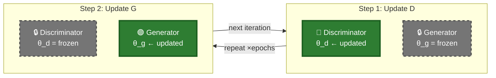
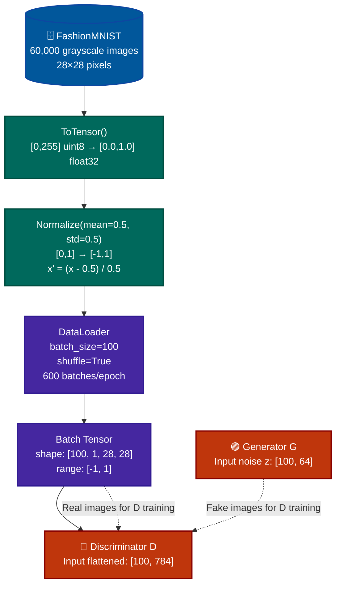
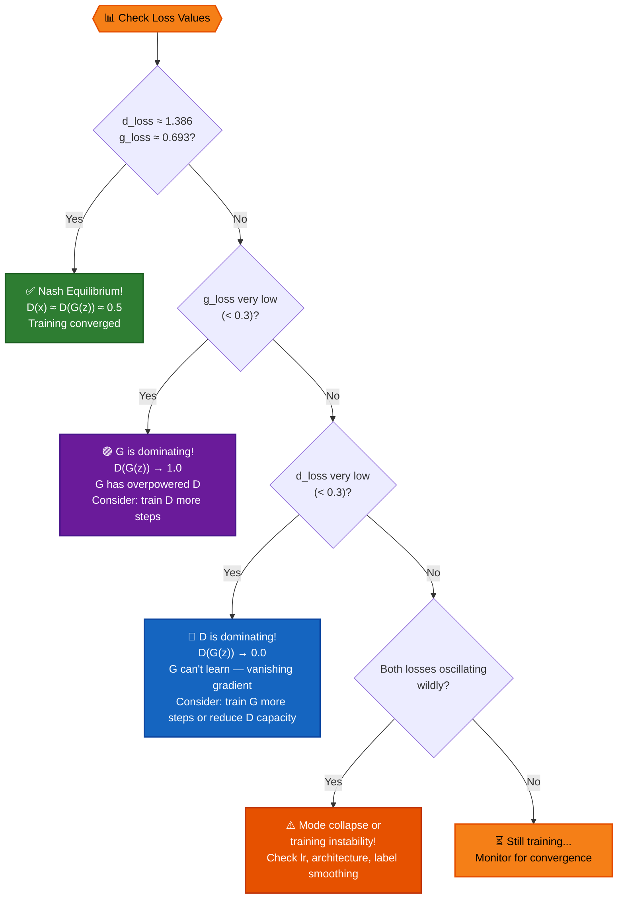

# 04 — GAN Training Dynamics
**Module 6: Generative AI & Deep Learning**
*Prof. Balaji Srinivasan & Ganapathy Krishnamurthi — Wadhwani School of AI, IIT Madras*

---

## Table of Contents
1. [The Minimax Game](#1-the-minimax-game)
2. [Training Algorithm Overview](#2-training-algorithm-overview)
3. [Phase 1 — Training the Discriminator](#3-phase-1--training-the-discriminator)
4. [Phase 2 — Training the Generator](#4-phase-2--training-the-generator)
5. [Alternating Optimization](#5-alternating-optimization)
6. [Data Pipeline](#6-data-pipeline)
7. [Implementation in PyTorch](#7-implementation-in-pytorch)
8. [Loss Interpretation & Nash Equilibrium](#8-loss-interpretation--nash-equilibrium)
9. [Training Results & Observations](#9-training-results--observations)
10. [Key Tricks & Insights](#10-key-tricks--insights)

---

## 1. The Minimax Game

The GAN training is framed as a **two-player minimax game** between the Generator $G$ and Discriminator $D$:

$$\min_G \max_D V(D, G) = \mathbb{E}_{x \sim p_{\text{data}}}[\log D(x)] + \mathbb{E}_{z \sim p_z}[\log(1 - D(G(z)))]$$

| Player | Role | Objective |
|--------|------|-----------|
| **Discriminator $D$** | Detective | Maximize $V(D,G)$ — distinguish real from fake |
| **Generator $G$** | Forger | Minimize $V(D,G)$ — fool the discriminator |

> [!IMPORTANT]
> Both networks are trained **alternately** — not simultaneously. When one is updated, the other's parameters are **frozen**.

---

## 2. Training Algorithm Overview

```mermaid
flowchart TD
    classDef start fill:#4CAF50,color:#fff,stroke:#388E3C,stroke-width:2px
    classDef dphase fill:#1565C0,color:#fff,stroke:#0D47A1,stroke-width:2px
    classDef gphase fill:#6A1B9A,color:#fff,stroke:#4A148C,stroke-width:2px
    classDef decision fill:#F57F17,color:#fff,stroke:#E65100,stroke-width:2px
    classDef end_node fill:#C62828,color:#fff,stroke:#B71C1C,stroke-width:2px

    A([🚀 Start Training]):::start --> B[Sample real x ~ p_data\nSample noise z ~ p_z]:::dphase

    subgraph D_PHASE ["🔵 Phase 1: Train Discriminator (G frozen)"]
        B --> C[Generate fake: G&#40z&#41]:::dphase
        C --> D[Compute D&#40x&#41 → real score\nCompute D&#40G&#40z&#41&#41 → fake score]:::dphase
        D --> E["Maximize: E[log D(x)] + E[log(1-D(G(z)))]"]:::dphase
        E --> F[Update θ_d via gradient ascent\nθ_d ← θ_d + α·∇_{θ_d} L_D]:::dphase
    end

    F --> G[Sample new noise z ~ p_z]:::gphase

    subgraph G_PHASE ["🟣 Phase 2: Train Generator (D frozen)"]
        G --> H[Generate fake: G&#40z&#41]:::gphase
        H --> I[Compute D&#40G&#40z&#41&#41 → fooling score]:::gphase
        I --> J["Minimize: E[log(1 - D(G(z)))]"]:::gphase
        J --> K[Update θ_g via gradient descent\nθ_g ← θ_g - α·∇_{θ_g} L_G]:::gphase
    end

    K --> L{Converged?}:::decision
    L -- No --> B
    L -- Yes --> M([✅ Training Complete]):::end_node
```

---

## 3. Phase 1 — Training the Discriminator

**Goal:** Make $D$ better at telling real images from fake ones.

### Mathematical Objective

$$\max_{\theta_d} \; \frac{1}{m} \sum_{i=1}^{m} \left[\log D(x^{(i)}) + \log\left(1 - D(G(z^{(i)}))\right)\right]$$

### Gradient Ascent Update

$$\theta_d \leftarrow \theta_d + \alpha \cdot \nabla_{\theta_d} \left[\frac{1}{m} \sum_{i=1}^{m} \log D(x^{(i)}) + \log(1 - D(G(z^{(i)})))\right]$$

### What D Learns

| Input | Label | Desired Output |
|-------|-------|----------------|
| Real image $x$ | 1 | $D(x) \to 1$ |
| Fake image $G(z)$ | 0 | $D(G(z)) \to 0$ |

> [!NOTE]
> During D's training phase, **G's parameters are frozen**. The generator only produces fake images as input data — it does not learn during this phase.

---

## 4. Phase 2 — Training the Generator

**Goal:** Make $G$ produce images so realistic that $D$ classifies them as real.

### Mathematical Objective

$$\min_{\theta_g} \; \frac{1}{m} \sum_{i=1}^{m} \log\left(1 - D(G(z^{(i)}))\right)$$

### Gradient Descent Update

$$\theta_g \leftarrow \theta_g - \alpha \cdot \nabla_{\theta_g} \left[\frac{1}{m} \sum_{i=1}^{m} \log(1 - D(G(z^{(i)})))\right]$$

> [!WARNING]
> The term $\log(1 - D(G(z)))$ has **vanishing gradients** early in training when $D(G(z)) \approx 0$ (D easily rejects all fakes). In practice, we flip the objective to **maximize** $\log(D(G(z)))$ instead — this is the **non-saturating** trick.

### Gradients Flow Through D to Update G

```
z → [G] → G(z) → [D] → D(G(z)) → Loss
                 ↑
         gradients flow back through D (D frozen, but used as a differentiable function)
         to reach G's parameters θ_g
```

> [!IMPORTANT]
> Even though D is *frozen* (not updated) during Phase 2, gradients still **flow backward through D** to reach G's parameters. D acts as a fixed but differentiable scoring function.

---

## 5. Alternating Optimization



**Summary of alternating steps:**

1. **Freeze $\theta_g$**, update $\theta_d$ (maximize D's objective)
2. **Freeze $\theta_d$**, update $\theta_g$ (minimize G's objective)
3. Repeat until **Nash Equilibrium**: $D(x) = D(G(z)) = 0.5$

At equilibrium, $D$ cannot do better than random guessing — meaning $G$ has perfectly learned $p_{\text{data}}$.

---

## 6. Data Pipeline



### Normalization Explained

The transform maps pixel values:

$$x' = \frac{x - \mu}{\sigma} = \frac{x - 0.5}{0.5}$$

| Original range | After transform |
|---------------|----------------|
| $[0, 1]$ | $[-1, 1]$ |

This matches the **Tanh output** of the Generator, which also outputs values in $[-1, 1]$.

**Denormalization** (for visualization):

```python
def denorm(x):
    out = (x + 1) / 2  # Convert from [-1, 1] to [0, 1]
    return out.clamp(0, 1)
```

---

## 7. Implementation in PyTorch

### 7.1 Setup — Loss & Optimizers

```python
# Loss and optimizers
criterion = nn.BCELoss()
d_optimizer = torch.optim.Adam(D.parameters(), lr=0.0002)
g_optimizer = torch.optim.Adam(G.parameters(), lr=0.0002)

def denorm(x):
    out = (x + 1) / 2  # Convert from [-1,1] to [0,1]
    return out.clamp(0, 1)

def reset_grad():
    d_optimizer.zero_grad()
    g_optimizer.zero_grad()
```

> [!NOTE]
> `nn.BCELoss()` computes: $L = -[y \cdot \log(\hat{y}) + (1-y) \cdot \log(1 - \hat{y})]$
> This is perfect for the binary classification task (real=1, fake=0).

---

### 7.2 Data Pipeline

```python
# FashionMNIST with normalization
transform = transforms.Compose([
    transforms.ToTensor(),
    transforms.Normalize(mean=(0.5,), std=(0.5,))  # Maps [0,1]→[-1,1]
])
train_dataset = torchvision.datasets.FashionMNIST(
    root='./data', train=True, transform=transform, download=True)
train_loader = DataLoader(train_dataset, batch_size=100, shuffle=True)
# 600 batches/epoch
```

---

### 7.3 Discriminator Training Step

```python
# Train with real images
outputs = D(images)
d_loss_real = criterion(outputs, real_labels)  # real_labels = 1
real_score = outputs

# Train with fake images
z = torch.randn(batch_size, latent_size).to(device)
fake_images = G(z)
outputs = D(fake_images)
d_loss_fake = criterion(outputs, fake_labels)  # fake_labels = 0
fake_score = outputs

# Combined discriminator loss
d_loss = d_loss_real + d_loss_fake
reset_grad()
d_loss.backward()
d_optimizer.step()
```

> [!TIP]
> **The `.detach()` trick for efficiency:** When training D with fake images, you can call `fake_images = G(z).detach()` before passing to D. This detaches the fake images from G's computation graph, so PyTorch does **not** compute or store gradients through G during D's backward pass — saving memory and computation. Since we don't need G's gradients in this phase anyway, it's a free optimization!
>
> ```python
> # More efficient version:
> fake_images = G(z).detach()  # Stop gradient flow into G
> outputs = D(fake_images)
> d_loss_fake = criterion(outputs, fake_labels)
> ```

---

### 7.4 Generator Training Step

```python
z = torch.randn(batch_size, latent_size).to(device)
fake_images = G(z)
outputs = D(fake_images)

# Generator wants D to think fake = real (use real_labels!)
g_loss = criterion(outputs, real_labels)  # KEY: use real_labels=1 here!
reset_grad()
g_loss.backward()
g_optimizer.step()
```

> [!IMPORTANT]
> **Why does G use `real_labels=1` in BCE?** This is the core insight of the non-saturating generator loss:
>
> - G's goal is to **maximize** $D(G(z))$ — make D think fakes are real.
> - If we used `fake_labels=0` as target: `BCE(D(G(z)), 0)` = $-\log(1 - D(G(z)))$. When D is good early on, $D(G(z)) \approx 0$, so $1 - D(G(z)) \approx 1$, and $\log(1) = 0$ → **gradient vanishes!** G can't learn.
> - Instead, using `real_labels=1` as target: `BCE(D(G(z)), 1)` = $-\log(D(G(z)))$. When $D(G(z)) \approx 0$, $\log(0) \to -\infty$ → **gradient is large!** G gets a strong learning signal.
>
> This is equivalent to **maximizing** $\log(D(G(z)))$ instead of minimizing $\log(1 - D(G(z)))$.

---

### 7.5 Model Saving

```python
torch.save(G.state_dict(), 'generator.pth')
torch.save(D.state_dict(), 'discriminator.pth')
```

---

## 8. Loss Interpretation & Nash Equilibrium

### BCE Loss Breakdown

| Loss Term | Formula | Meaning |
|-----------|---------|---------|
| `d_loss_real` | $\text{BCE}(D(x),\, 1)$ | How well D identifies **real** images |
| `d_loss_fake` | $\text{BCE}(D(G(z)),\, 0)$ | How well D identifies **fake** images |
| `g_loss` | $\text{BCE}(D(G(z)),\, 1)$ | How well G **fools** D |
| `d_loss` | `d_loss_real + d_loss_fake` | Total discriminator loss |

### Nash Equilibrium

At equilibrium, D outputs $0.5$ for everything (pure random guessing):

$$D(x) = D(G(z)) = 0.5$$

Computing ideal loss values:
$$\text{d\_loss\_real} = -\log(0.5) \approx 0.693$$
$$\text{d\_loss\_fake} = -\log(1 - 0.5) = -\log(0.5) \approx 0.693$$
$$\text{d\_loss} = 2 \times 0.693 \approx \mathbf{1.386}$$
$$\text{g\_loss} = -\log(0.5) \approx \mathbf{0.693}$$

> [!IMPORTANT]
> **Golden rule:** If `d_loss ≈ 1.386`, the GAN has reached Nash Equilibrium. The generator has perfectly learned the data distribution.

### Diagnosing Training Health



---

## 9. Training Results & Observations

### Experimental Setup

| Parameter | Value |
|-----------|-------|
| Dataset | FashionMNIST |
| Training images | 60,000 |
| Batch size | 100 |
| Batches/epoch | 600 |
| Epochs | 100 |
| Latent size | 64 |
| Learning rate | 0.0002 |
| Optimizer | Adam (both D and G) |
| Loss | Binary Cross Entropy |

### Final Results after 100 Epochs

| Metric | Value | Ideal |
|--------|-------|-------|
| Final D_loss | 0.8781 | 1.386 |
| Final G_loss | 1.5290 | 0.693 |
| Average D_loss | 0.7651 | 1.386 |
| Average G_loss | 2.0232 | 0.693 |
| Real score $D(x)$ | ≈ 0.75 | 0.5 |
| Fake score $D(G(z))$ | ≈ 0.30 | 0.5 |

> [!NOTE]
> The final values show that D is still slightly winning ($D(x) \approx 0.75 > 0.5$, $D(G(z)) \approx 0.30 < 0.5$). Full convergence to Nash equilibrium would require more epochs or tuning.

### Training Progression

| Phase | What Happens |
|-------|-------------|
| **Early epochs** | Noisy, unrecognizable images. D dominates. G_loss high, D_loss low. |
| **Mid epochs** | Recognizable shapes emerge. Losses begin converging. |
| **Late epochs** | Clear fashion item shapes. Losses approach equilibrium. |

**Loss curve behavior:**
- $G\_\text{loss}$: Starts **high** (D easily rejects all fakes), decreases as G improves
- $D\_\text{loss}$: Starts **low** (D easily wins), increases as G improves
- Both **converge toward equilibrium** values over training

### Score Tracking

| Epoch | $D(x)$ (real score) | $D(G(z))$ (fake score) | Interpretation |
|-------|---------------------|------------------------|---------------|
| Epoch 1 | ~0.95 | ~0.05 | D dominates completely |
| Epoch 10 | ~0.85 | ~0.15 | G starting to learn |
| Epoch 50 | ~0.78 | ~0.25 | G improving steadily |
| Epoch 100 | ~0.75 | ~0.30 | Approaching equilibrium |
| **Ideal** | **0.50** | **0.50** | **Nash Equilibrium** |

---

## 10. Key Tricks & Insights

### 10.1 The `.detach()` Trick

When training D with fake images, **detach the fake images from G's computation graph**:

```python
# Without .detach() — PyTorch stores gradients through G unnecessarily
fake_images = G(z)
d_loss_fake = criterion(D(fake_images), fake_labels)  # Stores G's graph!

# With .detach() — efficient: G's graph is NOT stored
fake_images = G(z).detach()
d_loss_fake = criterion(D(fake_images), fake_labels)  # Only D's graph stored
```

> [!TIP]
> `.detach()` creates a new tensor that shares the same data but is **detached from the computation graph**. No gradient will flow through it. This saves memory proportional to G's depth during D's backward pass.

---

### 10.2 Why G Uses `real_labels=1`

The generator loss in BCE terms:

| Label used | BCE formula | Gradient when $D(G(z)) \approx 0$ |
|------------|-------------|----------------------------------|
| `fake_labels=0` | $-\log(1 - D(G(z)))$ | $\approx \log(1) = 0$ → **Vanishes!** |
| `real_labels=1` | $-\log(D(G(z)))$ | $\approx -\log(0) \to \infty$ → **Strong!** |

Using `real_labels=1` implements the **non-saturating generator loss**:

$$L_G = -\mathbb{E}_{z \sim p_z}[\log D(G(z))] \quad \text{(instead of } \mathbb{E}_{z}[\log(1 - D(G(z)))])$$

> [!IMPORTANT]
> This is one of the most practical tricks from the original GAN paper. It doesn't change the game theory (G still wants to fool D), but it gives **much stronger gradients** for G early in training when it's weakest.

---

### 10.3 Summary of Best Practices

| Practice | Why |
|----------|-----|
| Use Adam with lr=0.0002 | Empirically stable for GANs |
| Normalize input to $[-1, 1]$ | Matches Tanh output of G |
| Use Tanh in G's output layer | Maps to $[-1, 1]$, matching normalized input |
| Use Sigmoid in D's output | Outputs probability $\in [0, 1]$ for BCE |
| Reset gradients before each backward | Prevents gradient accumulation across phases |
| Use `.detach()` when training D | Memory and compute efficiency |
| Use `real_labels=1` for G's loss | Non-saturating gradients for G |
| Monitor both $D(x)$ and $D(G(z))$ | Health check: should converge to 0.5 |

---

*End of Module 6 — GAN Training Dynamics Notes*
*IIT Madras | Wadhwani School of AI*
