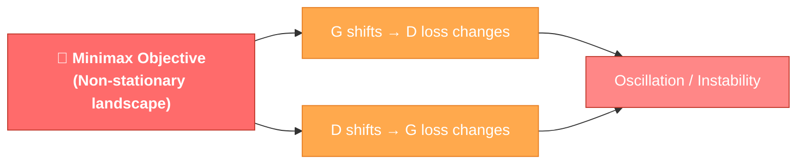
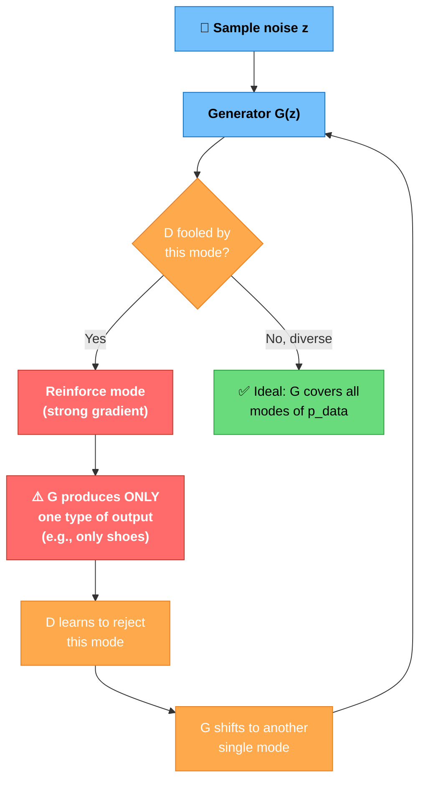
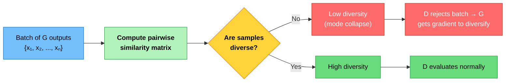
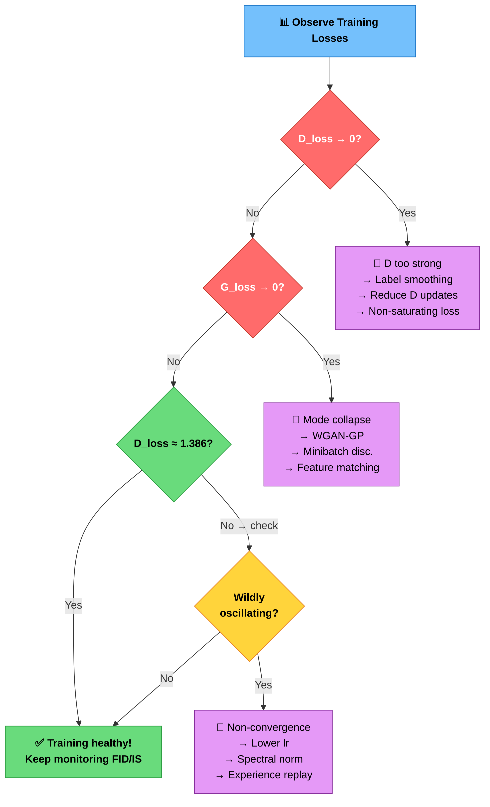
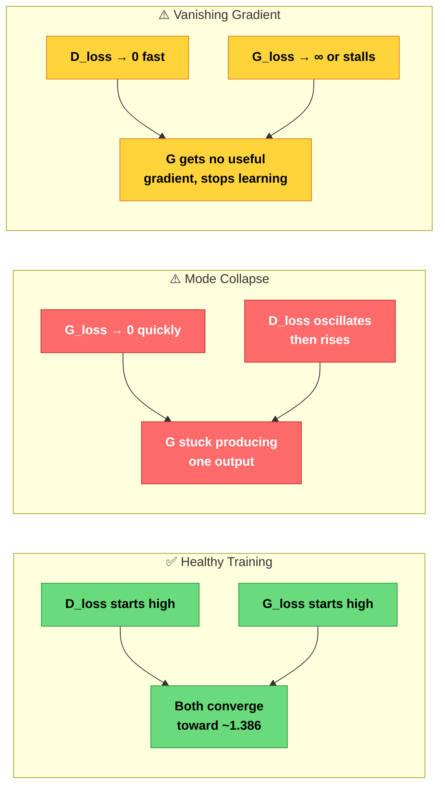

# Module 6 — GAN Challenges & Solutions
### IIT Madras | Wadhwani School of AI | Prof. Balaji Srinivasan & Ganapathy Krishnamurthi

---

> [!IMPORTANT]
> GANs are notoriously difficult to train. Understanding *why* they fail — and *how* to fix it — is as important as understanding the architecture itself. This note is your practical debugging guide.

---

## Table of Contents
1. [Why GANs Are Hard to Train](#1-why-gans-are-hard-to-train)
2. [Core Challenges](#2-core-challenges)
   - [Mode Collapse](#21-mode-collapse)
   - [Vanishing Gradients](#22-vanishing-gradients)
   - [Non-Convergence](#23-non-convergence)
   - [Hyperparameter Sensitivity](#24-hyperparameter-sensitivity)
3. [Solutions & Fixes](#3-solutions--fixes)
   - [Wasserstein GAN (WGAN)](#31-wasserstein-gan-wgan)
   - [Minibatch Discrimination](#32-minibatch-discrimination)
   - [Progressive Growing of GANs](#33-progressive-growing-of-gans)
   - [Other Practical Fixes](#34-other-practical-fixes)
4. [Challenge → Solution Map](#4-challenge--solution-map)
5. [GAN Loss Diagnosis](#5-gan-loss-diagnosis)
6. [Evaluation Metrics](#6-evaluation-metrics)
7. [Visual Diagrams](#7-visual-diagrams)
8. [References](#8-references)

---

## 1. Why GANs Are Hard to Train

GANs are fundamentally a **minimax game** between two neural networks:

$$\min_G \max_D \; \mathbb{E}_{x \sim p_{data}}[\log D(x)] + \mathbb{E}_{z \sim p_z}[\log(1 - D(G(z)))]$$

This adversarial objective, while elegant, makes optimization **unstable** by nature. Unlike standard supervised learning with a fixed loss landscape, both $G$ and $D$ keep shifting, so the landscape itself changes every update — making a stable Nash equilibrium very hard to reach in practice.



---

## 2. Core Challenges

### 2.1 Mode Collapse

> [!WARNING]
> **Mode collapse** is the single biggest difficulty in GAN training. The generator "cheats" by producing only a few types of output — perfectly fooling the discriminator but ignoring most of the real data distribution.

**How it happens, step by step:**

1. Generator $G$ finds that one particular output (e.g., shoe images) fools $D$ reliably.
2. $G$ receives strong gradient signal for that mode → reinforces this behaviour.
3. $G$ forgets all other modes and produces *only* shoes.
4. $D$ eventually learns to reject shoes → $G$ shifts to another single mode.
5. The cycle continues — the GAN **never** learns the full distribution $p_{data}$.



> [!NOTE]
> **Diagnosis signal:** If `G_loss → 0` (G wins completely), mode collapse is likely — G has found a small region it can exploit consistently.

---

### 2.2 Vanishing Gradients

When $D$ becomes too strong too quickly, the gradient flowing back to $G$ **vanishes**:

$$\text{Original G loss:} \quad \min_G \log(1 - D(G(z)))$$

When $D(G(z)) \approx 0$ (D always correctly rejects fakes):

$$\log(1 - D(G(z))) \approx \log(1) = 0 \quad \Rightarrow \quad \frac{\partial \mathcal{L}}{\partial G} \approx 0$$

The gradient of $G$ with respect to this term becomes **flat** — $G$ receives no useful learning signal and training stalls.

**Non-saturating fix (used in practice):**

| Loss variant | Formula | Gradient behavior |
|---|---|---|
| Original (saturating) | $\min_G \log(1 - D(G(z)))$ | ≈ 0 when D is good ❌ |
| Non-saturating | $\min_G -\log(D(G(z)))$ | Strong gradient even when D is good ✅ |

Both have the same Nash equilibrium but the non-saturating version **provides strong gradients** even when $D$ is confident. This is what most real implementations use.

> [!TIP]
> In PyTorch, using `BCEWithLogitsLoss` on flipped labels (treating fakes as "real" for the generator step) implements the non-saturating loss automatically.

---

### 2.3 Non-Convergence

The game between $G$ and $D$ may never reach a **Nash equilibrium**:

- Parameters oscillate rather than converge.
- $G$ and $D$ keep "chasing" each other.
- Losses fluctuate wildly without settling.

**Root cause:** Standard gradient descent is designed for single-objective minimization. Solving a minimax problem with alternating gradient steps is **not guaranteed to converge** — the two players can spiral around the equilibrium indefinitely.

---

### 2.4 Hyperparameter Sensitivity

GANs are **extremely sensitive** to small changes in:

| Hyperparameter | DCGAN recommended default | Why it matters |
|---|---|---|
| Learning rate | `lr = 0.0002` | Too high → instability; too low → no learning |
| Adam $\beta_1$ | `beta1 = 0.5` | Default 0.9 causes oscillations |
| $\beta_2$ | `beta2 = 0.999` | Standard |
| Architecture depth | Varies | Too deep → vanishing gradients |
| Batch size | 64–128 | Affects diversity seen by D |

> [!CAUTION]
> Never use the default PyTorch/TensorFlow Adam optimizer settings (`beta1=0.9`) for GANs. Always use `beta1=0.5` as per Radford et al. (DCGAN). Using `lr=0.0002` and Adam `(0.5, 0.999)` is a universal safe starting point.

---

## 3. Solutions & Fixes

### 3.1 Wasserstein GAN (WGAN)

**Reference:** Arjovsky et al., 2017

The core problem with the original GAN: when $p_{data}$ and $p_G$ have disjoint supports (which is common in high-dimensional spaces), the **JS divergence is useless** (constant $\log 2$), giving zero gradient.

**WGAN replaces JS divergence with the Wasserstein-1 (Earth Mover's) distance:**

$$W(p_r, p_g) = \inf_{\gamma \in \Pi(p_r, p_g)} \mathbb{E}_{(x,y) \sim \gamma}[\|x - y\|]$$

Intuitively: *the minimum "cost" to transport mass from $p_g$ to $p_r$.*

**WGAN objective:**

$$\min_G \max_{D \in \mathcal{D}} \; \mathbb{E}_{x \sim p_r}[D(x)] - \mathbb{E}_{z \sim p_z}[D(G(z))]$$

Where $\mathcal{D}$ is the set of 1-Lipschitz functions.

**Key changes from vanilla GAN:**

| Vanilla GAN | WGAN |
|---|---|
| Discriminator (outputs 0–1) | **Critic** (outputs real values, no sigmoid) |
| Binary Cross-Entropy loss | Wasserstein distance (no log) |
| No weight constraint | **Weight clipping** (to enforce Lipschitz) |
| `BCELoss` | `mean(real) - mean(fake)` |

> [!NOTE]
> **WGAN-GP (Gradient Penalty)** — Gulrajani et al. 2017 — improves on weight clipping by adding a soft penalty term directly on the gradient norm, avoiding the pathologies weight clipping can cause:
>
> $$\mathcal{L}_{GP} = \lambda \, \mathbb{E}_{\hat{x}}[(\|\nabla_{\hat{x}} D(\hat{x})\|_2 - 1)^2]$$

**Why WGAN reduces mode collapse:** By minimizing the distance between *entire distributions* (not just at a point), $G$ is incentivized to cover all modes of $p_{data}$.

---

### 3.2 Minibatch Discrimination

**Reference:** Salimans et al., 2016

Standard training evaluates each sample independently — $D$ can't detect if the *whole batch* is homogeneous. Minibatch discrimination fixes this:

1. $D$ computes a **similarity score** across all samples in a minibatch.
2. If all fakes look the same → high similarity → $D$ rejects the whole batch.
3. This creates direct gradient pressure on $G$ to produce **diverse** outputs.



---

### 3.3 Progressive Growing of GANs

**Reference:** Karras et al., 2018

Generating high-resolution images (1024×1024) from scratch is extremely hard. **Progressive growing** breaks this into stages:

**Training stages:**

$$4 \times 4 \;\to\; 8 \times 8 \;\to\; 16 \times 16 \;\to\; 32 \times 32 \;\to\; \cdots \;\to\; 1024 \times 1024$$

At each stage, **new layers are added** to both $G$ and $D$, and learned gradually through a fade-in mechanism (mixing old and new resolution outputs with a parameter $\alpha$).

**Why it works:**
- Low-resolution training is a simpler problem → networks converge reliably.
- High-level structure (pose, identity) is learned first; fine details come later.
- Gradient paths are shorter at early stages → more stable.

> [!NOTE]
> Progressive growing is the foundation of **StyleGAN** (Karras et al., 2019), which extends it with style-based control and achieves state-of-the-art photorealistic face generation.

---

### 3.4 Other Practical Fixes

| Technique | What it does | When to use |
|---|---|---|
| **Non-saturating Loss** | Flip G objective to `max log D(G(z))` | Always — standard default |
| **Label Smoothing** | Use `0.9` instead of `1.0` for real labels | Prevents D from becoming overconfident |
| **Spectral Normalization** | Normalizes weight matrices $W \leftarrow W / \sigma(W)$ | Stabilizes D training generally |
| **Different D/G update ratios** | Train D for $k$ steps per 1 G step | When D is underpowered |
| **Feature Matching** | G trained to match D's intermediate activations | Reduces mode collapse, improves stability |
| **Experience Replay** | D also trains on old fake images | Prevents G from cycling/oscillating |
| **Gradient Penalty (WGAN-GP)** | Soft Lipschitz constraint via penalty | Better than weight clipping |

> [!TIP]
> **Label smoothing in code:**
> ```python
> # Instead of target = torch.ones(batch_size)
> target = torch.full((batch_size,), 0.9)  # real labels = 0.9, not 1.0
> ```
> This prevents D from becoming so confident that the gradients flowing to G are essentially zero.

---

## 4. Challenge → Solution Map

```mermaid
flowchart TD
    classDef challenge fill:#ff6b6b,stroke:#c0392b,color:#fff,font-weight:bold
    classDef solution fill:#69db7c,stroke:#2f9e44,color:#000,font-weight:bold
    classDef metric fill:#74c0fc,stroke:#1971c2,color:#000

    MC["⚠️ Mode Collapse"]:::challenge
    VG["⚠️ Vanishing Gradients"]:::challenge
    NC["⚠️ Non-Convergence"]:::challenge
    HS["⚠️ Hyperparameter\nSensitivity"]:::challenge

    W["✅ WGAN / WGAN-GP\n(Earth Mover's Distance)"]:::solution
    MB["✅ Minibatch\nDiscrimination"]:::solution
    NS["✅ Non-Saturating Loss\nmax log D(G(z))"]:::solution
    SN["✅ Spectral\nNormalization"]:::solution
    PG["✅ Progressive Growing\nof GANs"]:::solution
    LS["✅ Label Smoothing\n(real labels = 0.9)"]:::solution
    FM["✅ Feature Matching"]:::solution
    ER["✅ Experience Replay\n(History of Fakes)"]:::solution
    GP["✅ DCGAN Defaults\nlr=0.0002, β₁=0.5"]:::solution

    MC --> W
    MC --> MB
    MC --> FM
    VG --> NS
    VG --> SN
    VG --> PG
    NC --> ER
    NC --> SN
    HS --> GP
    HS --> LS
```



---

## 5. GAN Loss Diagnosis

### Reading Your Loss Curves

The **theoretical Nash equilibrium** of a GAN produces:

$$D_{\text{loss}} = -2 \log(0.5) \approx 1.386$$

This is because at equilibrium, $D(x) = 0.5$ for all inputs — $D$ cannot distinguish real from fake.

### Diagnosis Table

| $D_\text{loss}$ | $G_\text{loss}$ | Diagnosis | Action |
|---|---|---|---|
| → 0 | Very high | D is dominating; G gets no gradient | Reduce D capacity; use non-saturating loss; label smoothing |
| Very low | → 0 | G is dominating; likely mode collapse | WGAN; minibatch discrimination; feature matching |
| ≈ 1.386 | ≈ 1.386 | ✅ Nash equilibrium — healthy training | Keep monitoring |
| Oscillates wildly | Oscillates wildly | Non-convergence | Lower lr; spectral norm; experience replay |
| Stable but not 1.386 | Stable but not 1.386 | Possibly stuck in suboptimal equilibrium | Try different architecture; progressive growing |



---

## 6. Evaluation Metrics

Evaluating GANs is non-trivial — visual inspection alone is insufficient for reproducible research.

### 6.1 Inception Score (IS)

$$IS = \exp\!\left(\mathbb{E}_{x}\left[\text{KL}\!\left(p(y|x) \;\|\; p(y)\right)\right]\right)$$

Where:
- $p(y|x)$ = class probabilities for generated image $x$ from an Inception network.
- $p(y) = \int p(y|x) p(x) dx$ = marginal over all generated images.

**Higher IS = better.** A good generator should:
- Produce **high-quality** images ($p(y|x)$ is peaky → high confidence per image).
- Produce **diverse** images ($p(y)$ is flat → many classes represented).

> [!WARNING]
> IS has known flaws: it doesn't compare to the real data distribution, can be gamed, and doesn't detect memorization of training data.

### 6.2 Fréchet Inception Distance (FID)

**Reference:** Heusel et al., 2017

The **current standard metric** for GAN evaluation:

$$\text{FID} = \|\mu_r - \mu_g\|^2 + \text{Tr}\!\left(\Sigma_r + \Sigma_g - 2(\Sigma_r \Sigma_g)^{1/2}\right)$$

Where:
- $\mu_r, \Sigma_r$ = mean and covariance of real images in Inception feature space.
- $\mu_g, \Sigma_g$ = mean and covariance of generated images in Inception feature space.

**Lower FID = better.** It measures both quality and diversity by comparing feature distributions.

### 6.3 Precision & Recall

Decomposes quality and diversity into separate metrics:
- **Precision** = fraction of generated images that are realistic (quality).
- **Recall** = fraction of the real distribution that is covered by generated images (diversity).

A model with high precision but low recall has mode collapse; high recall but low precision generates blurry/realistic-looking but diverse outputs.

### Metric Comparison Table

| Metric | Measures | Range | Better | Accounts for real data? | Problems |
|---|---|---|---|---|---|
| **IS** | Quality + diversity via class distribution | [1, ∞) | Higher | ❌ No | Can be gamed; ignores real distribution |
| **FID** | Full distribution match in feature space | [0, ∞) | Lower | ✅ Yes | Needs large sample (≥10k); depends on Inception |
| **Precision** | Sample quality | [0, 1] | Higher | ✅ Yes | Requires real data embeddings |
| **Recall** | Distribution coverage (diversity) | [0, 1] | Higher | ✅ Yes | Sensitive to outliers |
| **Visual inspection** | Subjective quality | Subjective | — | ❌ | Not reproducible; misses subtle failures |

> [!TIP]
> Always report **FID** as the primary metric in papers. Use Precision & Recall to separately diagnose quality vs diversity trade-offs. IS is now considered legacy but still appears in many published comparisons.

---

## 7. Visual Diagrams

### Healthy vs. Pathological Loss Curves (Schematic)



---

## 8. References

| Citation | Paper | Contribution |
|---|---|---|
| Arjovsky et al., 2017 | *Wasserstein GAN* | Earth Mover's Distance for GAN training, weight clipping |
| Salimans et al., 2016 | *Improved Techniques for Training GANs* | Minibatch discrimination, feature matching, label smoothing |
| Karras et al., 2018 | *Progressive Growing of GANs for Improved Quality, Stability, and Variation* | Progressive training, the foundation of StyleGAN |
| Heusel et al., 2017 | *GANs Trained by a Two Time-Scale Update Rule Converge to a Local Nash Equilibrium* | Fréchet Inception Distance (FID) metric |
| Gulrajani et al., 2017 | *Improved Training of Wasserstein GANs* | Gradient Penalty (WGAN-GP) |
| Radford et al., 2015 | *Unsupervised Representation Learning with Deep Convolutional GANs (DCGAN)* | Architecture guidelines: lr=0.0002, β₁=0.5 |

---

> [!NOTE]
> **Summary of practical GAN training recipe:**
> 1. Use **non-saturating loss** for G by default.
> 2. Apply **label smoothing** (real = 0.9) to prevent D overconfidence.
> 3. Use **Adam with lr=0.0002 and β₁=0.5**.
> 4. Monitor losses: target D_loss ≈ 1.386.
> 5. If mode collapse → switch to **WGAN-GP** and add **minibatch discrimination**.
> 6. If vanishing gradients → add **spectral normalization** and check D update ratio.
> 7. Evaluate quantitatively with **FID** (lower is better).
