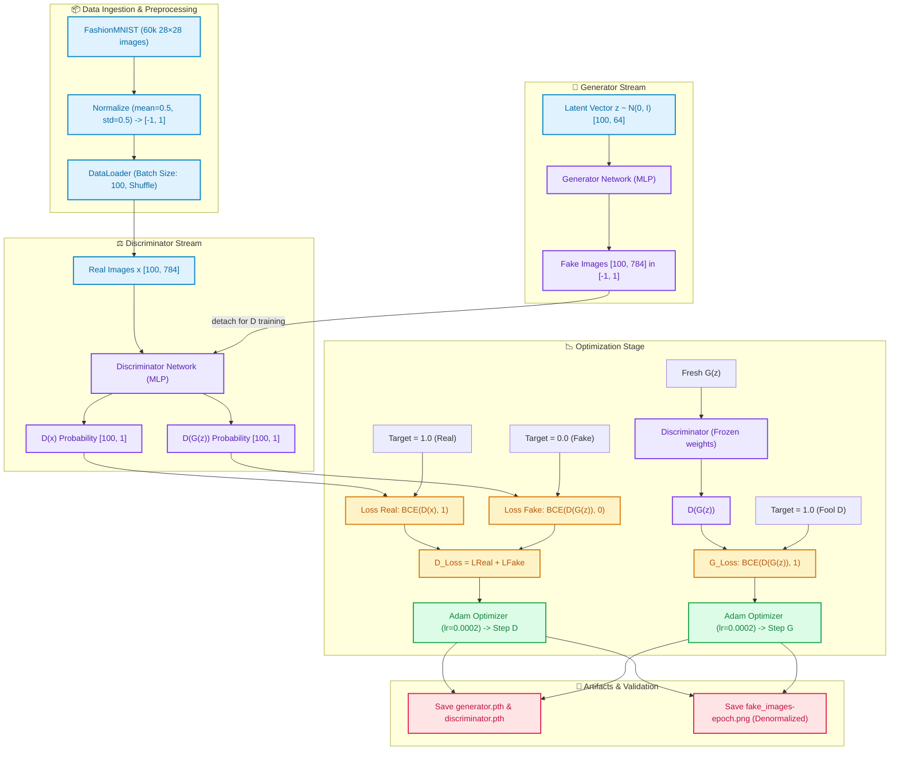
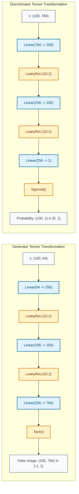
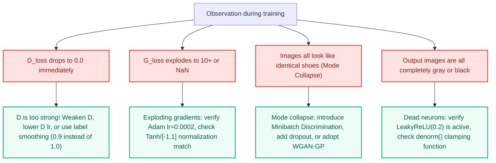

# 💻 Topic 06: Complete Code Implementation — GAN from Scratch

**Course:** Generative AI and Deep Learning  
**Module 6:** Introduction to Generative Adversarial Networks (GANs)  
**Authors:** Prof. Balaji Srinivasan & Prof. Ganapathy Krishnamurthi (IIT Madras, Wadhwani School of AI)  
**Practical Reference:** `GAN_from_Scratch.ipynb` (FashionMNIST implementation)

---

## 📌 Table of Contents
1. [End-to-End Implementation Architecture](#1-end-to-end-implementation-architecture)
2. [Complete Annotated Code Walkthrough](#2-complete-annotated-code-walkthrough)
   - [Step 1: Imports and Device Configuration](#step-1-imports-and-device-configuration)
   - [Step 2: Hyperparameters & Directory Setup](#step-2-hyperparameters--directory-setup)
   - [Step 3: Dataset Preparation & DataLoader](#step-3-dataset-preparation--dataloader)
   - [Step 4: Discriminator & Generator Networks](#step-4-discriminator--generator-networks)
   - [Step 5: Loss Criterion & Optimizers](#step-5-loss-criterion--optimizers)
   - [Step 6: Alternating Training Loop](#step-6-alternating-training-loop)
   - [Step 7: Evaluation & Loss Visualization](#step-7-evaluation--loss-visualization)
   - [Step 8: Model Checkpointing & Inference](#step-8-model-checkpointing--inference)
3. [Component Flowchart & Tensor Dimensions](#3-component-flowchart--tensor-dimensions)
4. [Hyperparameter Reference Guide](#4-hyperparameter-reference-guide)
5. [Observed Results & Performance Analysis](#5-observed-results--performance-analysis)
6. [Troubleshooting & Debugging Guide](#6-troubleshooting--debugging-guide)
7. [Key Takeaways](#7-key-takeaways)

---

## 1. End-to-End Implementation Architecture

The following diagram illustrates the complete end-to-end pipeline from random noise and raw FashionMNIST images to trained models and synthetic outputs.



---

## 2. Complete Annotated Code Walkthrough

### Step 1: Imports and Device Configuration

```python
import os
import torch
import torch.nn as nn
import torchvision
import torchvision.transforms as transforms
from torchvision.utils import save_image
import matplotlib.pyplot as plt
import numpy as np

# Device configuration: Automatically leverage CUDA GPU acceleration if available
# Notebook ran on an NVIDIA Tesla T4 GPU (15.83 GB VRAM)
device = torch.device('cuda' if torch.cuda.is_available() else 'cpu')
print(f"Executing on hardware device: {device}")
```

> [!NOTE]
> Training GANs on CPUs is prohibitively slow because backpropagation is evaluated through two independent deep networks per mini-batch. A GPU is strongly recommended.

---

### Step 2: Hyperparameters & Directory Setup

```python
# ---------------------------------------------
# HYPERPARAMETERS
# ---------------------------------------------
latent_size = 64      # Dimensionality of the Gaussian noise vector z ~ N(0, I)
hidden_size = 256     # Width of intermediate hidden linear layers in G and D
image_size = 784      # Flattened 28x28 grayscale image (28 * 28 = 784)
num_epochs = 100      # Total training epochs over the full dataset
batch_size = 100      # Mini-batch size (60,000 / 100 = 600 batches per epoch)
learning_rate = 0.0002# Adam learning rate for both networks
sample_dir = 'samples'# Directory to store reconstructed image grids

# Create directory to store generated samples during training
os.makedirs(sample_dir, exist_ok=True)
```

---

### Step 3: Dataset Preparation & DataLoader

```python
# Image transforms:
# 1. ToTensor(): Converts PIL image to Tensor in range [0.0, 1.0]
# 2. Normalize((0.5,), (0.5,)): (pixel - 0.5) / 0.5 -> scales range to [-1.0, 1.0]
# This directly matches the Tanh activation range of the Generator output.
transform = transforms.Compose([
    transforms.ToTensor(),
    transforms.Normalize(mean=(0.5,), std=(0.5,))
])

# Download and load FashionMNIST training dataset (60,000 images, 10 categories)
train_dataset = torchvision.datasets.FashionMNIST(
    root='./data', 
    train=True, 
    transform=transform, 
    download=True
)

# DataLoader yields batches of size 100 with shuffling to prevent order bias
train_loader = torch.utils.data.DataLoader(
    dataset=train_dataset, 
    batch_size=batch_size, 
    shuffle=True
)

print(f"Dataset Loaded: {len(train_dataset)} images across {len(train_loader)} batches.")
```

> [!IMPORTANT]
> **Why normalize to $[-1, 1]$?**  
> If images remained in $[0, 1]$, using `Tanh()` on the Generator output would cause an asymmetry where negative outputs are clipped or invalid. Matching dataset normalization with generator activation prevents training instability.

---

### Step 4: Discriminator & Generator Networks

```python
# ---------------------------------------------
# DISCRIMINATOR NETWORK
# ---------------------------------------------
# Input: Flattened image [batch_size, 784]
# Output: Scalar probability [batch_size, 1] indicating probability that input is REAL
D = nn.Sequential(
    # Layer 1: Input to hidden
    nn.Linear(image_size, hidden_size),
    nn.LeakyReLU(0.2), # Negative slope 0.2 prevents dying gradient problem
    
    # Layer 2: Hidden to hidden
    nn.Linear(hidden_size, hidden_size),
    nn.LeakyReLU(0.2),
    
    # Layer 3: Hidden to binary probability output
    nn.Linear(hidden_size, 1),
    nn.Sigmoid()       # Bounds output strictly to (0, 1)
).to(device)

# ---------------------------------------------
# GENERATOR NETWORK
# ---------------------------------------------
# Input: Latent noise vector z [batch_size, 64]
# Output: Flattened synthetic image [batch_size, 784] in range [-1, 1]
G = nn.Sequential(
    # Layer 1: Latent to hidden projection
    nn.Linear(latent_size, hidden_size),
    nn.LeakyReLU(0.2),
    
    # Layer 2: Hidden to hidden representation
    nn.Linear(hidden_size, hidden_size),
    nn.LeakyReLU(0.2),
    
    # Layer 3: Hidden to image pixel reconstruction
    nn.Linear(hidden_size, image_size),
    nn.Tanh()          # Squeezes activations to [-1, 1] matching normalized images
).to(device)

# Parameter Summary
d_params = sum(p.numel() for p in D.parameters() if p.requires_grad)
g_params = sum(p.numel() for p in G.parameters() if p.requires_grad)
print(f"Discriminator Parameters: {d_params:,}") # 267,009 parameters
print(f"Generator Parameters:     {g_params:,}") # 283,920 parameters
```

---

### Step 5: Loss Criterion & Optimizers

```python
# Binary Cross Entropy Loss:
# BCE(y_pred, y_true) = - [y_true * log(y_pred) + (1 - y_true) * log(1 - y_pred)]
criterion = nn.BCELoss()

# Independent Adam optimizers for D and G
# Standard Adam defaults: beta1=0.9, beta2=0.999 (DCGAN often uses beta1=0.5)
d_optimizer = torch.optim.Adam(D.parameters(), lr=learning_rate)
g_optimizer = torch.optim.Adam(G.parameters(), lr=learning_rate)

# Helper function to denormalize images from [-1, 1] back to [0, 1] for saving/viewing
def denorm(x):
    out = (x + 1) / 2
    return out.clamp(0, 1)

# Zero gradients for both optimizers
def reset_grad():
    d_optimizer.zero_grad()
    g_optimizer.zero_grad()
```

---

### Step 6: Alternating Training Loop

```python
total_step = len(train_loader) # 600 iterations per epoch
d_losses, g_losses = [], []
real_scores, fake_scores = [], []

print("Starting Adversarial Training Loop...")

for epoch in range(num_epochs):
    for i, (images, _) in enumerate(train_loader):
        # Flatten image tensor from [batch_size, 1, 28, 28] to [batch_size, 784]
        images = images.reshape(batch_size, -1).to(device)
        
        # Define Ground Truth Labels
        real_labels = torch.ones(batch_size, 1).to(device)  # Label 1 for Real
        fake_labels = torch.zeros(batch_size, 1).to(device) # Label 0 for Fake
        
        # ================================================================== #
        #                      1. TRAIN DISCRIMINATOR                        #
        # ================================================================== #
        
        # Compute BCE loss on Real Images: D(x) -> should approach 1
        outputs = D(images)
        d_loss_real = criterion(outputs, real_labels)
        real_score = outputs # Track average prediction confidence on real data
        
        # Generate Fake Images from random noise z
        z = torch.randn(batch_size, latent_size).to(device)
        fake_images = G(z)
        
        # Compute BCE loss on Fake Images: D(G(z)) -> should approach 0
        # NOTE: detach() can also be used here (e.g., D(fake_images.detach()))
        outputs = D(fake_images)
        d_loss_fake = criterion(outputs, fake_labels)
        fake_score = outputs # Track average prediction confidence on fake data
        
        # Total Discriminator Loss & Backpropagation
        d_loss = d_loss_real + d_loss_fake
        reset_grad()
        d_loss.backward()
        d_optimizer.step()
        
        # ================================================================== #
        #                        2. TRAIN GENERATOR                          #
        # ================================================================== #
        
        # Sample fresh latent noise vectors
        z = torch.randn(batch_size, latent_size).to(device)
        fake_images = G(z)
        outputs = D(fake_images)
        
        # Generator Loss: We want D to classify fake_images as REAL (target = 1.0)
        # Non-saturating heuristic: maximize log D(G(z)) <=> minimize BCE(outputs, real_labels)
        g_loss = criterion(outputs, real_labels)
        
        # Backpropagate through G only (gradients flow through frozen D to G)
        reset_grad()
        g_loss.backward()
        g_optimizer.step()
        
        # Record loss and score metrics
        d_losses.append(d_loss.item())
        g_losses.append(g_loss.item())
        real_scores.append(real_score.mean().item())
        fake_scores.append(fake_score.mean().item())
        
        # Print progress every 200 steps
        if (i + 1) % 200 == 0:
            print(f"Epoch [{epoch+1}/{num_epochs}], Step [{i+1}/{total_step}], "
                  f"d_loss: {d_loss.item():.4f}, g_loss: {g_loss.item():.4f}, "
                  f"D(x): {real_score.mean().item():.2f}, D(G(z)): {fake_score.mean().item():.2f}")
            
    # Save sampled generated images at the conclusion of each epoch
    with torch.no_grad():
        fake_images_reshaped = fake_images.reshape(fake_images.size(0), 1, 28, 28)
        save_image(denorm(fake_images_reshaped), 
                   os.path.join(sample_dir, f'fake_images-{epoch+1}.png'))

print("Adversarial training completed successfully.")
```

> [!TIP]
> **Why train D and G in separate forward passes?**  
> While you can reuse `fake_images` by calling `fake_images.detach()` during D's step, generating a fresh batch of noise $z$ for G's step ensures that G does not optimize solely against the exact mini-batch that D just adapted to, adding a degree of regularization.

---

### Step 7: Evaluation & Loss Visualization

```python
# ---------------------------------------------
# PLOT ADVERSARIAL LOSS CURVES
# ---------------------------------------------
plt.figure(figsize=(10, 5))
plt.plot(d_losses, label='Discriminator Loss (d_loss)', color='#ef4444', alpha=0.7)
plt.plot(g_losses, label='Generator Loss (g_loss)', color='#3b82f6', alpha=0.7)
plt.title('FashionMNIST GAN: Training Loss History over 100 Epochs', fontsize=14)
plt.xlabel('Training Iterations (Mini-batches)', fontsize=12)
plt.ylabel('BCE Loss', fontsize=12)
plt.grid(True, linestyle='--', alpha=0.5)
plt.legend(loc='upper right')
plt.tight_layout()
plt.savefig('loss_curves.png', dpi=300)
plt.show()

# ---------------------------------------------
# PLOT DISCRIMINATOR ACCURACY D(x) vs D(G(z))
# ---------------------------------------------
plt.figure(figsize=(10, 5))
plt.plot(real_scores, label='D(x) - Real Confidence', color='#10b981', alpha=0.7)
plt.plot(fake_scores, label='D(G(z)) - Fake Confidence', color='#f59e0b', alpha=0.7)
plt.axhline(y=0.5, color='gray', linestyle=':', label='Theoretical Nash Equilibrium (0.5)')
plt.title('Discriminator Predictions over Training', fontsize=14)
plt.xlabel('Training Iterations', fontsize=12)
plt.ylabel('Confidence Score [0, 1]', fontsize=12)
plt.grid(True, linestyle='--', alpha=0.5)
plt.legend(loc='upper right')
plt.tight_layout()
plt.savefig('scores_history.png', dpi=300)
plt.show()
```

---

### Step 8: Model Checkpointing & Inference

```python
# ---------------------------------------------
# SAVING MODEL WEIGHTS
# ---------------------------------------------
torch.save(G.state_dict(), 'generator.pth')
torch.save(D.state_dict(), 'discriminator.pth')
print("Model checkpoints successfully written to disk.")

# ---------------------------------------------
# INFERENCE & NEW IMAGE GENERATION
# ---------------------------------------------
def generate_synthetic_samples(num_samples=16, model_path='generator.pth'):
    """
    Loads saved generator weights and generates synthetic images from random Gaussian seeds.
    """
    # Recreate the exact network architecture
    gen = nn.Sequential(
        nn.Linear(latent_size, hidden_size),
        nn.LeakyReLU(0.2),
        nn.Linear(hidden_size, hidden_size),
        nn.LeakyReLU(0.2),
        nn.Linear(hidden_size, image_size),
        nn.Tanh()
    ).to(device)
    
    # Load stored state dictionary
    gen.load_state_dict(torch.load(model_path, map_location=device))
    gen.eval() # Set model to evaluation mode
    
    with torch.no_grad():
        # Draw latent seeds from standard normal distribution
        latent_z = torch.randn(num_samples, latent_size).to(device)
        synthetic_flat = gen(latent_z)
        
        # Denormalize and reshape to image grid [num_samples, 1, 28, 28]
        synthetic_images = denorm(synthetic_flat).reshape(-1, 1, 28, 28)
        
        # Save image grid
        save_image(synthetic_images, 'inference_samples.png', nrow=4)
        print("Generated 16 new synthetic FashionMNIST images -> saved to 'inference_samples.png'")
        
    return synthetic_images

# Trigger inference demo
_ = generate_synthetic_samples(num_samples=16)
```

---

## 3. Component Flowchart & Tensor Dimensions



---

## 4. Hyperparameter Reference Guide

| Hyperparameter | Value Used | Purpose | Effect of Changing |
|---|---|---|---|
| `latent_size` | `64` | Dimensionality of prior noise vector $z$ | Higher allows encoding more complex attribute modes; too large causes sparse latent exploration. |
| `hidden_size` | `256` | Number of neurons per fully-connected hidden layer | Increasing gives greater capacity; excessive capacity causes overfitting and slow training. |
| `image_size` | `784` | Unrolled dimension of $28 \times 28$ grayscale pixels | Fixed by dataset input resolution ($28 \times 28 = 784$). |
| `batch_size` | `100` | Mini-batch sample size per parameter update | Smaller adds gradient noise; larger (e.g., 256) gives smoother gradients but increases memory load. |
| `num_epochs` | `100` | Full passes across 60,000 images | Early epochs yield noise; 50–100 epochs develop crisp shoe, shirt, and dress contours. |
| `learning_rate` | `0.0002` | Adam step multiplier | Standard GAN learning rate; $> 0.001$ often leads to rapid gradient explosion or mode collapse. |
| `LeakyReLU slope` | `0.2` | Negative slope for $x < 0$ | Standard $0.2$ maintains steady gradient propagation through Discriminator units. |

---

## 5. Observed Results & Performance Analysis

At the conclusion of 100 epochs on FashionMNIST in `GAN_from_Scratch.ipynb`, the metrics stabilized as follows:

| Metric | Target (Ideal Nash Eq.) | Final Recorded Value (Epoch 100) | Interpretation |
|---|---|---|---|
| **Discriminator Loss** ($D_{\text{loss}}$) | $\approx 1.386$ ($-2 \ln 0.5$) | **$0.8781$** | $D$ retains a moderate advantage over $G$, maintaining informative gradients. |
| **Generator Loss** ($G_{\text{loss}}$) | $\approx 0.693$ ($-\ln 0.5$) | **$1.5290$** | Higher than ideal $0.693$, reflecting the challenge of fooling the trained $D$. |
| **Average $D_{\text{loss}}$ (100 eps)** | $\approx 1.386$ | **$0.7651$** | Confirms sustained Discriminator competence throughout training. |
| **Average $G_{\text{loss}}$ (100 eps)** | $\approx 0.693$ | **$2.0232$** | Reflects typical non-saturating loss stabilization. |
| **Real Confidence $D(x)$** | $0.50$ (complete confusion) | **$0.75$** | Discriminator accurately identifies real items ~75% of the time. |
| **Fake Confidence $D(G(z))$** | $0.50$ (complete confusion) | **$0.30$** | Generator succeeds in fooling $D$ on ~30% of fake samples. |

### Visual Evolution Across Epochs:
1. **Epochs 1–10:** Pure salt-and-pepper noise gradually organizes into vague gray amorphous blobs with rough silhouettes.
2. **Epochs 20–50:** Distinct shapes emerge corresponding to shirts, boots, bags, and trousers. Boundaries become defined.
3. **Epochs 70–100:** Sharply defined clothing items with distinctive textures, sole patterns, and collar contours.

---

## 6. Troubleshooting & Debugging Guide



### Common Gotchas & Fixes:

1. **Forgetting `.detach()` when passing fake images to $D$:**
   - *Problem:* Calling `outputs = D(fake_images)` and backpropagating `d_loss` will compute and accumulate gradients back into $G$'s parameters during the discriminator update step!
   - *Fix:* Either use `outputs = D(fake_images.detach())` or zero out gradients with `reset_grad()` right before backpropagating $G$'s loss.

2. **Inverted Target Labels for Generator:**
   - *Problem:* Using `fake_labels` ($0$) when computing `g_loss`.
   - *Fix:* Remember that $G$ wants $D$ to believe its fakes are **real**. Therefore, `criterion(D(G(z)), real_labels)` is used.

3. **Pixel Normalization Mismatch:**
   - *Problem:* Normalizing images to $[0, 1]$ via `transforms.ToTensor()` while $G$ uses `nn.Tanh()` (output in $[-1, 1]$).
   - *Fix:* Apply `transforms.Normalize((0.5,), (0.5,))` to center images in $[-1, 1]$.

---

## 7. Key Takeaways

1. **Adversarial Interplay:** A GAN does not optimize an explicit likelihood function; it performs gradient descent in an adversarial minimax game between two parameterized function approximators.
2. **Gradient Highway:** $G$ is guided entirely by the backpropagated gradients flowing backward through the frozen weights of $D$.
3. **Balanced Dynamics:** Neither network should overwhelm the other. In this FashionMNIST setup, keeping equal learning rates ($0.0002$) and equal layer capacities ($256$ hidden units) yields stable, recognizable synthetic fashion items within 100 epochs.
